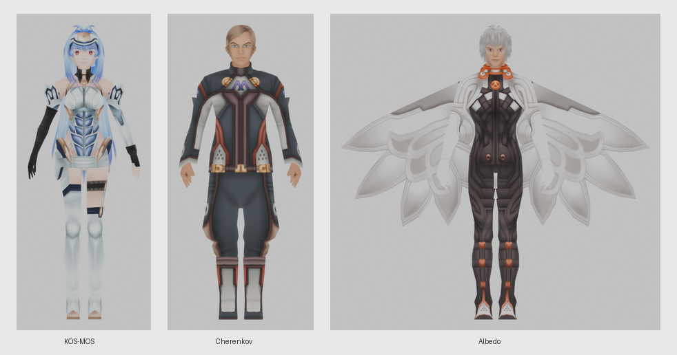
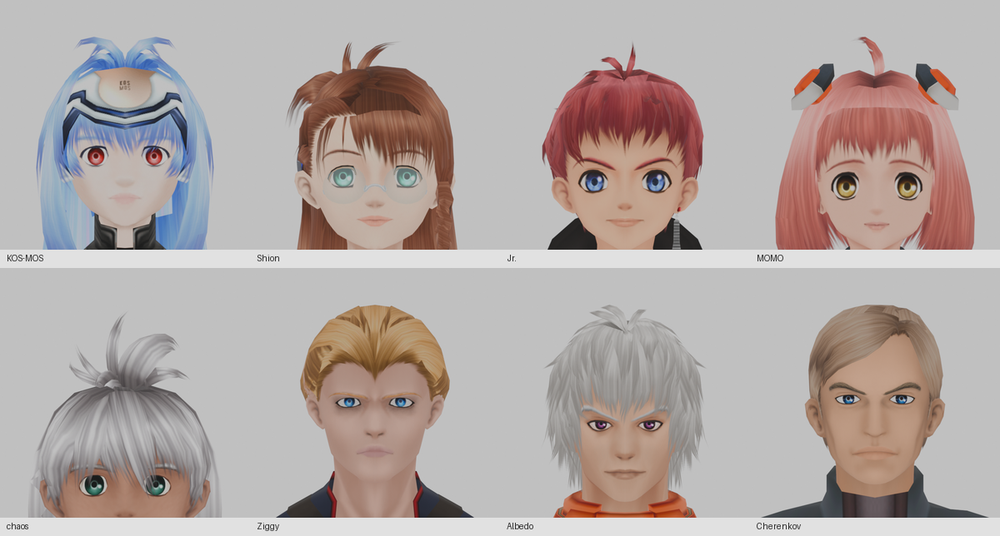
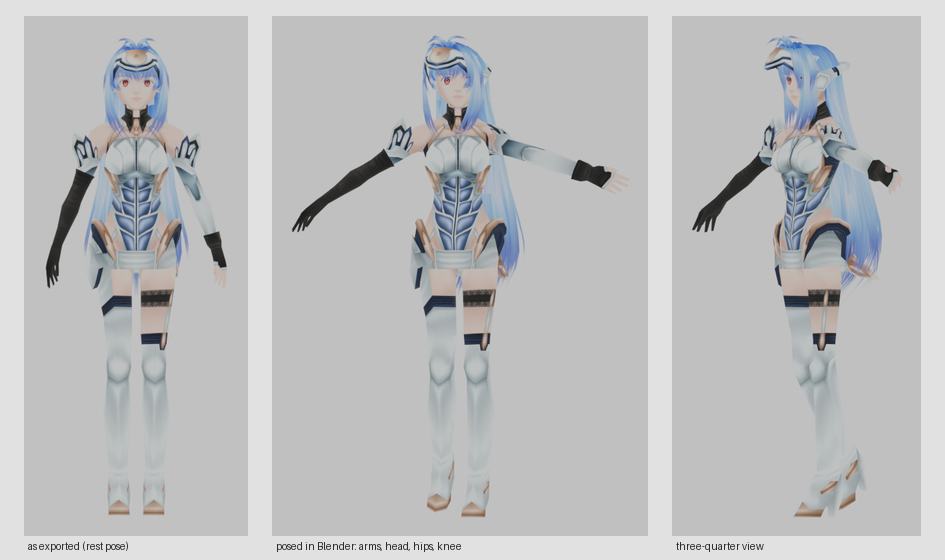
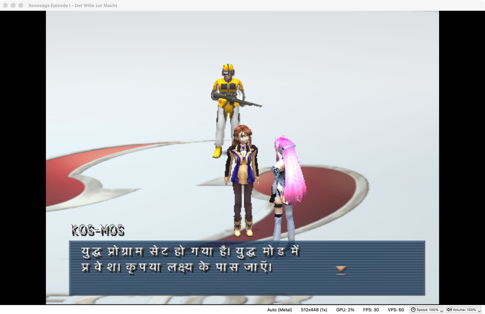
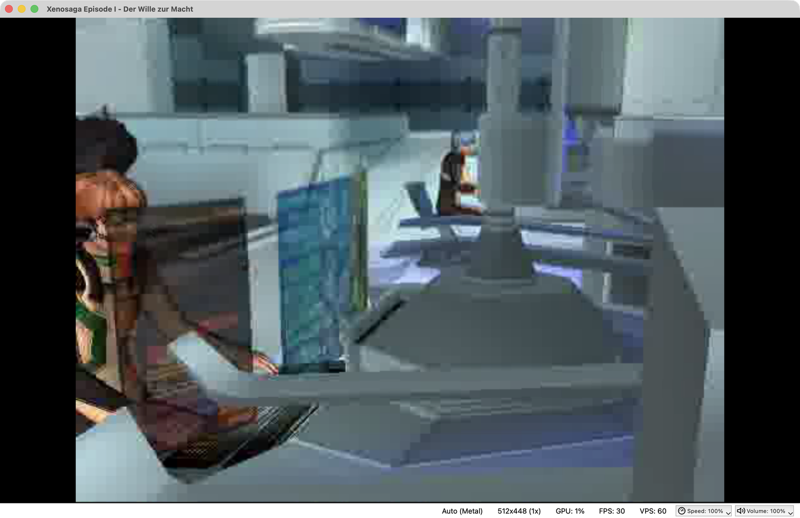
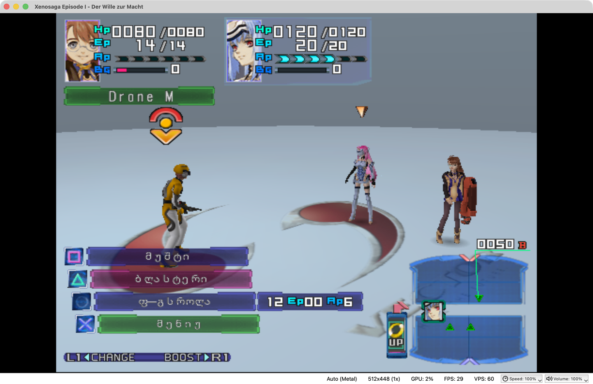
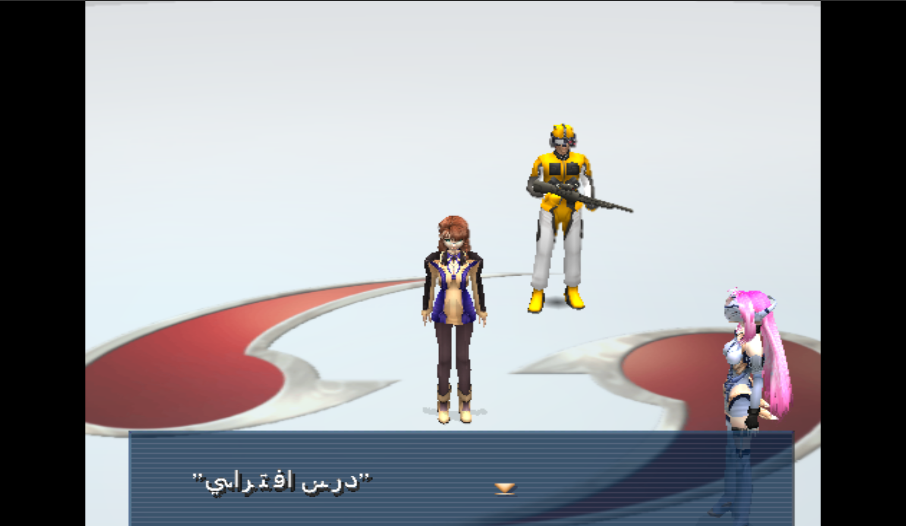
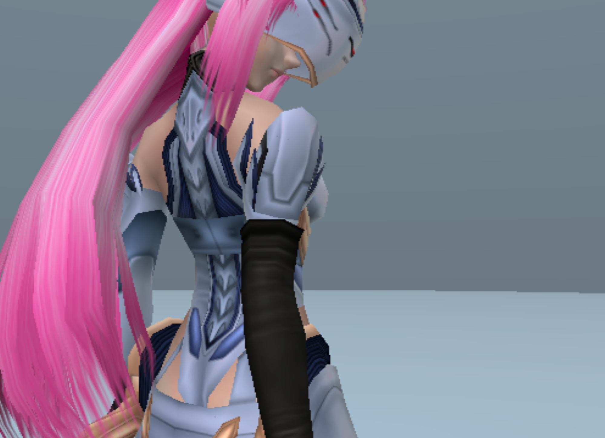
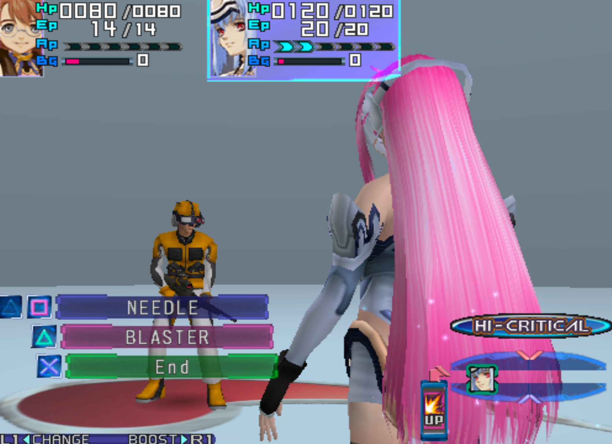

# Xenosaga Episode I Python Extractor

Unpack, browse and mod **Xenosaga Episode I — Der Wille zur Macht** (PS2,
USA release SLUS-20469) with nothing but Python. Point it at your own disc
image and you get every file on the disc in a form your computer can
open: textures as PNG, **models as glTF for Blender**, voices and music
as WAV, cutscenes as MP4, game text as UTF-8, and the cutscene scripts as
Java you can read. Then write your changes back to a bootable ISO.

The kit ships no game data. You need your own copy of the disc.







The game running from a disc the kit rebuilt, captured in PCSX2 (nothing composited):

| | |
|---|---|
|  |  |
|  |  |

## What's new (October 2026)

* **Translation without length limits.** Cutscene and field dialogue now
  exports and imports like the rest of the text (`evt-export` /
  `evt-import`, any length, all three chains), mails may grow, and an
  object that no longer fits its slot on the disc can be relocated
  (`--grow`). The second layer's chain of 89 cutscenes, 58 movies and 44
  voice streams is read like the other two.
* **Scripts the game never had.** The fonts are decoded and rebuilt
  byte-exactly, and `lang scan` / `lang encode` draw a translation's
  Arabic, Hebrew, Devanagari (or any HarfBuzz-shaped script) glyphs from a
  TrueType font into the game's proportional font and encode the text
  shaped, wrapped and right-to-left where it should be. Two scripts can
  share one font pair (`--extend`), mixed-script words keep their Latin
  halves, and the disc's own symbols and control codes pass through.
  Menu and battle words, which live as C strings in the code overlays,
  are a third tree (`ovl-export` / `ovl-import`, any length), and the
  battle screen's own bitmap font gets new letters with `statfont`. Movie
  subtitles are rendered by the kit in any script and burned on a black
  bar over the English with plain ffmpeg (`subs-burn --font`), timed from the
  original with `subs-template --detect`. All of it seen running on
  PCSX2, drawn by the game itself: Hindi dialogue and menus, Georgian
  battle bars, a Hindi movie subtitle, an Arabic line, an Amharic mail.
  [docs/SCRIPTS.md](docs/SCRIPTS.md). Several of the formats behind this
  were first worked out by poketony for the Korean localisation
  [XS1KOR](https://github.com/poketony/XS1KOR).
* **Models open in Blender, rigged.** Every character, enemy, weapon,
  mech, prop and map on the disc comes out as a `.glb` with its texture
  inside. File ▸ Import ▸ glTF 2.0 and you have the mesh, its UVs,
  vertex colours, skin weights and a posable armature built from the
  game's own skeleton files, every bone on the mesh: select it, Pose
  Mode, grab a bone and rotate. Faces are merged into their bodies.
  How-to and what to expect: [docs/BLENDER.md](docs/BLENDER.md).
* **Faces are complete.** Eyes, mouths and eyelashes on every character,
  the lashes being the last piece: they are a small true-colour alpha
  strip the lash polygons stretch into strokes, and the decoder had been
  reading it through a palette. The gallery above is rendered by Blender
  straight from the kit's output.
* **Character textures look right, eyelashes included.** Opening models in Blender showed
  four texture bugs that had been there since the first release, and
  all are fixed: 42 character atlases that came out as beige noise
  (Cherenkov, Jr., MOMO, Shion and Virgil variants among them), sleeves
  and trims drawn with the wrong palette, hair sheets half-missing, and
  the texture scale on narrower atlases. 756 of the 1,019 model
  textures on the disc changed, all for the better.
* **The casino is fixed.** Card faces, the slot machine and the
  concept-art gallery were the last textures that came out wrong. The
  game's menu code says which palette colours which part of a sheet,
  and the kit now reads that. This closes GitHub issue #1.
* **More to look at and listen to.** Battle shouts and attack sounds,
  the casino art and gallery sketches, the title and help screens from
  the menu containers, the memory-card icon, and every string table the
  kit can sniff out of binary files, including the casino dialogue.
* **The soundtrack plays.** The sequenced music is rendered to WAV and
  FLAC, with MIDI and SoundFont files alongside, at the right tempo.
  The story of how: [docs/MUSIC.md](docs/MUSIC.md).

Still on the list: animation (the motion packs are located but not
decoded, so bones pose but do not play) and a few map meshes in formats
the model parser skips. The full change log is in [docs/UPDATES.md](docs/UPDATES.md).

## Running it

There is a point-and-click app and a command line. Both do the same
things.

**The app.** Download the bundle for your system from the Releases
page and double-click it. Nothing to install.

| | |
|---|---|
| Windows | `Xenosaga-I-Extractor-windows/Xenosaga-I-Extractor.exe` |
| macOS | `Xenosaga-I-Extractor.app` (first time: right-click ▸ Open, because of Gatekeeper) |

**From a source checkout** (Python 3.9 or newer, no packages to
install): double-click `launch.bat` (Windows), `launch.command` (macOS)
or `launch.sh` (Linux), or run `python gui.py`. The app opens as a page
in your browser, finds your disc image, and shows one card per job
with a live log.

**From a terminal:**

```sh
python cli.py extract --iso "Xenosaga Episode I (USA).iso" --out out/ --code
python cli.py classes --iso "Xenosaga Episode I (USA).iso" --out out/
python cli.py browse  --out out/
```

`extract` unpacks the disc into `out/dump/`. `browse` converts it into
`out/browse/`, which is the folder you actually open: PNGs, GLBs, WAVs,
MP4s and text. A guided tour of what is in there, and which folders are
worth opening first, is in [docs/BROWSING.md](docs/BROWSING.md).

## What you get

Everything on the disc, converted to something you can open.

**Pictures and models**

* Every texture as PNG: characters, enemies, mechs, props, maps, menus,
  the card game's 117 card faces, and the casino's slot reels, poker
  tables and the pencil concept sketches hidden in its gallery.
* 1,400 more textures pulled out of effect, scene and menu containers:
  battle effects, title and help screens, room backdrops.
* Every model as a `.glb` with its texture inside, ready for Blender.
* The 58 full cutscene movies the disc hides on its second layer, as
  MP4 with sound, plus 189 smaller in-game clips. The boot logos and
  title art. The memory-card icon.

**Sound**

* Every voice line and cutscene mix as WAV.
* Every battle shout and attack sound: 535 banks, one per character
  and boss, about 1,500 WAVs.
* The whole soundtrack, rendered from the sequenced music the disc
  actually carries (Yasunori Mitsuda's name is literally in the files),
  as WAV and FLAC, with the MIDI and SoundFont alongside so you can
  remix it. [docs/MUSIC.md](docs/MUSIC.md) tells the story.

**Hear it.** Two short excerpts straight out of the kit, so you know
what to expect before you run it: the opening of
[Battle 1, rendered from the sequenced music](docs/media/battle1-excerpt.mp3)
(15 s), [a voice line from the streamed cutscene audio](docs/media/voice-line-excerpt.mp3)
(8 s), and [a string of battle shouts](docs/media/battle-shouts-excerpt.mp3)
from Jr., KOS-MOS, MOMO and Ziggy's attack and boost banks
(16 s). Click to play in the browser. Everything else, the full tracks
and all 103 voice streams, comes from your own disc.

**Words and code**

* All in-game text as UTF-8: menus, text boxes, the U.M.N. mails, item
  descriptions, the casino dialogue, and the developers' own Japanese
  comments left in the scene scripts.
* The cutscene scripts as Java class files you can decompile and read
  ([docs/JAVA.md](docs/JAVA.md)).
* The executables with every function name intact.
* Eight developers' personal working folders that shipped on the retail
  disc, test maps and all ([docs/FINDS.md](docs/FINDS.md)).

| | Where | Format |
|---|---|---|
| Textures | `browse/textures_png/` | PNG |
| Models | `browse/models/` | glTF binary (`.glb`) |
| Voices and cutscene audio | `browse/audio/` | WAV |
| Battle voices and sound effects | `browse/battle_audio/` | WAV |
| Music | `browse/music/` (the **Render the soundtrack** card, or `music-export`) | WAV, FLAC, MIDI, SoundFont |
| Movies | `browse/movies/` | MP4 |
| Game text | `browse/text/` | UTF-8 |
| Cutscene scripts | `browse/classes/` | Java class files |
| Executables | `browse/code/` | ELF and IRX |

## Translating the game

The kit is built to carry a fan translation end to end, and the
pipeline has been proven in-game.

* **Menus, text boxes and mails.** `text-export` writes all 914 text
  objects as plain UTF-8 files, one per object, each marked with how
  many bytes it may use. Edit them in anything. `text-import` checks
  every file fits, re-encodes it, and writes a patched ISO only when all
  of them pass.
* **Cutscene dialogue.** Spoken lines in cutscenes live inside the Java
  scripts. `evt-export` writes them out, one line per string, and
  `evt-import` rebuilds the scripts around translations of any length.
  Objects that outgrow their place on the disc are relocated with
  `--grow`. Same-length byte swaps still work for a quick in-game check;
  the opening tutorial has been played through in French that way.
* **Other alphabets.** `lang scan` builds the glyphs your translation
  uses from a TrueType font into the game's font files; `lang encode`
  shapes, wraps and orders the text (right-to-left for Arabic and Hebrew)
  and writes the codes the importers take. [docs/SCRIPTS.md](docs/SCRIPTS.md).
* **Movie subtitles.** The cutscene movies have no subtitle track at all,
  so the kit gives you a timing template, lets you write and time the
  lines in any SRT editor, and burns them into the video with the
  original audio untouched. [docs/SUBTITLES.md](docs/SUBTITLES.md).
* **Guides.** A step-by-step French walkthrough in
  [docs/FRENCH-TRANSLATION-GUIDE.md](docs/FRENCH-TRANSLATION-GUIDE.md),
  the multi-script pipeline in [docs/SCRIPTS.md](docs/SCRIPTS.md), and
  the original right-to-left design notes in
  [docs/ARABIC-TRANSLATION-SPEC.md](docs/ARABIC-TRANSLATION-SPEC.md).

## Modding

The disc is unusually friendly to patching. The kit writes changes back
**in place**, so everything you did not touch stays byte-for-byte the
same as the retail disc.

* **Replace any file:** `python cli.py patch --iso GAME.iso --out MODDED.iso --set 'chain0:char\pc\kosmos.xtx=my_kosmos.xtx'`
* **Recolour KOS-MOS's hair** with one click (`pinkhair`). It is the
  worked example because the texture is stored in twelve places on the
  disc and the kit finds all of them.
* **Translate it.** See the section above; the same patcher writes the
  translated text and subtitled movies back.

| | |
|---|---|
|  |  |

How all of that works, in enough detail to build on:
[docs/MODDING.md](docs/MODDING.md).

## How the disc is put together

Three things explain most of what the kit does.

* **The disc has seven big files and nothing else.** `XENOSAGA.00` to
  `.13` hold all the game data. Read `.00+.01+.02` end to end and you
  have "chain 0", the game world: 8,573 models, textures, scripts and
  sound banks. `.10` to `.13` are chain 1, the streamed voice and
  cutscene data. A table of contents at the front of each chain maps
  game paths like `char\pc\kosmos.xtx` to where the bytes are.
* **Half the disc is invisible.** The second layer of the DVD is not in
  the filesystem at all. It is 58 full cutscene movies that the game
  plays by raw sector number. The kit finds them by scanning.
* **About 2,100 files are compressed** with Monolith's own ARX scheme.
  The kit's compressor is a byte-perfect clone of the original, which
  is what makes clean patching possible.

Two bonuses for the curious: every executable still has its function
names, and the cutscenes are compiled Java 1.1, debug info and all.
The disc also shipped eight developers' personal working folders;
[docs/FINDS.md](docs/FINDS.md) and [docs/HISTORY.md](docs/HISTORY.md)
have those stories.

The Japanese release is expected to work (nothing is tied to the USA
serial) but has not been tested on a real JP disc. If something breaks,
please open an issue with the exact error.

## Docs

| Read this | When you want to |
|---|---|
| [BROWSING.md](docs/BROWSING.md) | know what is in the output and where to look first |
| [BLENDER.md](docs/BLENDER.md) | bring the models into Blender |
| [MODDING.md](docs/MODDING.md) | change the game: patching, recolours, translation, verification |
| [SUBTITLES.md](docs/SUBTITLES.md) | add subtitles to the cutscenes |
| [FRENCH-TRANSLATION-GUIDE.md](docs/FRENCH-TRANSLATION-GUIDE.md), [SCRIPTS.md](docs/SCRIPTS.md), [ARABIC-TRANSLATION-SPEC.md](docs/ARABIC-TRANSLATION-SPEC.md) | translate the game, step by step; into other alphabets |
| [MUSIC.md](docs/MUSIC.md) | understand and render the soundtrack |
| [JAVA.md](docs/JAVA.md) | read the cutscene scripts |
| [FORMATS.md](docs/FORMATS.md) | see the byte-level details of every file format |
| [CODEBASE.md](docs/CODEBASE.md) | find your way around the code |
| [UPDATES.md](docs/UPDATES.md) | see what changed and when |
| [FINDS.md](docs/FINDS.md), [HISTORY.md](docs/HISTORY.md) | enjoy the leftovers and the history the disc records |

## Building the app yourself

`python build.py` (needs `pip install pyinstaller`) makes the
self-contained bundle. Build on Windows for the `.exe` and on macOS for
the `.app`; the GitHub Actions workflow builds both when a version tag
is pushed.

## Credits

ARX decompression, the texture canvas layout and the model format were
learned from [Lakuwu's xenotool](https://github.com/Lakuwu/xenotool) and
re-implemented here, with credit where each piece is used in
[docs/FORMATS.md](docs/FORMATS.md). The font files' GS layout, the FL00
shift rules for resized classes, the mail objects' pointer table and the
idea of relocating grown objects rather than rebuilding the disc were
first worked out by poketony for [XS1KOR](https://github.com/poketony/XS1KOR),
the Korean localisation of the Japanese release, and re-implemented here
for the USA disc; the engine-side cell addressing, the proportional-slot
permutation and the metrics semantics were recovered from the
executable for this kit. The ARX compressor, the table of
contents, the hidden-layer movie carver, the Java class carver, the
audio and music decoders, the overlay-palette and model-material
texture work, and the whole repack layer were reverse-engineered for
this kit.
