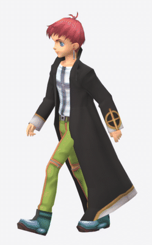

# The models in Blender

Run `browse` with the **Models** box ticked (or `--kinds models` on the
command line) and every `.lex` model on the disc becomes a `.glb` file
under `browse/models/`, in the same folders the game uses:

```
browse/models/chain0/char/pc/kosmos.glb        KOS-MOS, face included
browse/models/chain0/char/pc/kosmos_face.glb   just her face
browse/models/chain0/char/pc/kosmos_h.glb      her alternate outfit
browse/models/chain0/char/npc/andrew.glb       Cherenkov
browse/models/chain0/enemy/… robo/… weapon/… obj/… map/…
```

Each file carries its texture inside it, so there are no paths to fix
up. Drop one into Blender and it just works.

## Importing

1. **File ▸ Import ▸ glTF 2.0** and pick the `.glb`.
2. Leave the importer settings alone.
3. Press `Z` and choose **Material Preview** so you see the textures.

Blender 2.8 or newer, no add-ons needed.

## What you will see

**Objects.** One per game mesh, named `number/group/bone`, for example
`01/kosmos_mune/kosmos_body`. The group is the artist's name for the
part; the bone is what it hangs off. Parts that came from a separate
face file are prefixed with that file's name.

**Materials.** Named after the region of the texture they use, like
`mat3_u256-320_v128-256`. They all share one image. Hair materials end
in `_rgba` and eyelashes in `_lash`; both blend, everything else uses a
cut-out alpha.

**Vertex colours** in the `Col` attribute. That is the game's baked-in
shading tint. If a model looks too dark, unplug the Color Attribute node
from Base Color in the material.

**An armature** named after the character, built from the `.jnt`
skeleton file: the real joint hierarchy in the game's pose, plus the
face file's own small skeleton for eyes and mouth. Every bone sits on
the mesh, arms and hair included; the skin weights are the game's own,
as vertex groups named `j<number>` for the rotation joints, with the
offset, translate and bone-end nodes in between. You can pose the
character straight away.

**Bone display.** Blender's importer gives every bone an icosphere
shape, so a 121-bone character looks covered in spiky balls. Select the
armature, Properties ▸ Armature ▸ Viewport Display ▸ Display As: Stick
(and tick In Front), or in the importer options set Bone Shape to
"Blender" before importing.

**Scale.** The game works in metres, Y up, same as glTF. KOS-MOS stands
1.73 m tall and lands upright on Blender's floor with no scaling.

## Which files to open

| Folder under `browse/models/chain0/` | What is in it |
|---|---|
| `char/pc/` | the party: `kosmos`, `shion`, `jr`, `momo`, `chaos`, `ziggy`; `*1`, `*2`, `*_h` are alternate outfits; `*_face` are the face parts (already merged into the body files) |
| `char/npc/` | every NPC; Cherenkov is `andrew`, Albedo is `albelt` |
| `enemy/`, `enemy/boss/` | enemies and bosses |
| `robo/` | the A.G.W.S. mechs |
| `weapon/pc/` | weapons |
| `obj/` | props |
| `map/` | field and battle maps (`MC_BTL*` are the battle arenas; large) |

A body file already includes its companions: anything in the same
folder whose name starts with the body's name and has no texture of its
own (`kosmos_face.lex`, `kosmos_h_face.lex`). The companions are also
written on their own, so `kosmos_face.glb` is there if you only want
the head.

## A moving model, step by step



This is the whole road from your disc to a character walking in Blender,
for someone who has not used the kit before. Checked with Blender 5.4;
any recent Blender should do the same, and no add-ons are needed. The
motion is newer than the v1.3.0 app, so until the next release run the
kit from a source checkout (`launch.bat`, `launch.command` or `launch.sh`;
see "Running it" in the [README](../README.md#running-it)).

**1. Extract the disc.** In the app, card 2, **Extract assets**: pick your
disc image and an output folder. On the command line:

```sh
python cli.py extract --iso GAME.iso --out out/
```

This writes the game's own files under `out/dump/`. It takes a while
and is done once.

**2. Write the models, with their motion.** Either all of them or one.

* *All of them:* card 4, **Convert for browsing**, with **Models** ticked
  (`python cli.py browse --out out/ --kinds models`). Every model lands
  under `out/browse/models/`, each with every clip made for its skeleton
  already inside it. The whole pass took 26 minutes on a recent Mac.
* *One character, with the clips you choose:* card 15, **One model with
  its motion**. Give it the model's path on the disc and, if you like, a
  motion pack with the slots you want; leave the pack empty to get every
  clip made for that skeleton. On the command line:

  ```sh
  python cli.py model --dump out/dump --path 'char\pc\jr.lex' --out jr.glb \
         --motion 'motion\jr_cf.fpk#1,3'
  ```

  The paths use the game's backslashes; keep the quotes. Card 16, **List
  or check the motion packs** (`python cli.py motion --dump out/dump --pack
  'motion\jr_cf.fpk'`), shows which slots a pack has and how long each is.
  The party's field packs are `motion\<name>_cf.fpk` (`kosmos`, `shion`,
  `jr`, `momo`, `chaos`, `ziggy`). The clips have no names on the disc: in
  KOS-MOS's and Jr.'s field packs slot 1 looks like a walk and slot 3 like a run, and
  slot 0 is a standing loop.

**3. Set Blender to 30 frames a second, before importing.** Output
properties (the printer icon) ▸ Frame Rate ▸ 30. The game runs its clips
at 30 frames a second; at Blender's default of 24 they still play at the
right speed, but their keys fall between frames, and changing the rate
after importing changes the speed.

**4. Import.** File ▸ Import ▸ glTF 2.0, pick the `.glb`, leave the
options as they are. Press `Z` and choose **Material Preview** to see the
textures.

**Make the hair draw right.** The see-through parts (hair, eyelashes) come
in with Blender's *Blended* render method, which sorts see-through
surfaces per object, not per triangle. KOS-MOS's hair is several layers in
one object, so its inner layers get drawn over its outer ones and the hair
looks as if it has holes in it. The mesh is whole; switch the materials to
*Dithered*, which needs no sorting: select a hair part, Material
properties ▸ Settings ▸ Render Method ▸ **Dithered**. For every material at
once, paste this into the Python Console (Scripting workspace) and press
Enter:

```python
for m in bpy.data.materials: m.surface_render_method = 'DITHERED'
```

That is for Blender 4.2 and newer; in older versions set Blend Mode to
Alpha Hashed. Cycles draws the hair right either way.

In the Outliner you will find:

* `skeleton`, the armature: the game's joints as bones (`j45`, `j46`, …,
  with `node`, `offset` and `end` nodes between them);
* one mesh per game part, parented to `skeleton` with an Armature
  modifier, so it follows the bones;
* small `end…` empties hanging off bones: they mark where a chain of
  bones ends and move with them. Hide them if they are in the way.

**5. Play a clip.** The first clip is already on the armature: press
Space. The scene's end frame stays at Blender's 250, so set **End** in the
Timeline to the clip's length (26 for `motion/jr_cf#01`; the list in step
2 and each strip in the NLA editor show it), or the last pose holds until
frame 250.

**6. Pick another clip.** Every clip is in the file as its own action,
named after its pack and slot (`motion/jr_cf#03`). Select the armature,
switch a window to the **Dope Sheet**, set its mode to **Action Editor**,
and choose the action from the drop-down next to its name. The importer
also lays every clip out as a muted track in the **NLA Editor**, which is
the place to line clips up one after another.

**7. See the bones.** Select `skeleton`, then Properties ▸ Armature (the
running-figure icon) ▸ Viewport Display: tick **In Front** so the bones
show through the mesh, and set Display As to **Stick** if the default
shapes are too busy. Switch to Pose Mode (`Ctrl Tab`) to select a bone;
the Dope Sheet then shows its keys. You can pose bones by hand on top of
a clip or with no clip at all.

**What moves and why.** Every bone the clip stores is keyed once a frame.
The legs are solved the way the game solves them, toward a target near
each foot, and the action holds the result; the targets themselves are
not in the file. Hair, skirts, dresses and coats are not in the clips at
all: the game simulates them while a clip plays, and the kit runs the
same simulation and keys where it puts them, which is why Jr.'s coat
swings behind his legs above. The face is a set of small bones under the
head bone and follows it; eyes and mouths do not animate.

**If something looks wrong.**

* *Parts or the whole model stand still:* the armature has no action. Pick
  one in the Action Editor (step 6).
* *Holes or dark notches in the hair:* the hair is still on the Blended
  render method. Switch it to Dithered (step 4).
* *Two copies of the same character imported:* Blender adds `.001` to the
  second file's action names; pick the action ending in `.001` for it.
* *The clip plays too fast or too slow:* the frame rate was changed after
  importing. Set it to 30 and import again.
* *Spiky balls on every bone:* see "Bone display" above.
* *A character you wanted has no actions:* not every model has motion made
  for its skeleton (171 of the 1,317 models on the USA disc do). Cutscene
  motion is in `mtnpack\` and is attached only when you name a pack in
  step 2.

<br clear="right">

How the clips are read, what is simulated and what was checked:
[MOTION.md](MOTION.md).

## Known gaps

* **Animation has not been compared with the running game.** Hair,
  skirts and coats are baked from a port of the game's simulation; there
  is no wind ([MOTION.md](MOTION.md), "What is not done").
* Two map meshes use vertex formats the parser skips, and blend shapes
  are ignored. Anything skipped is listed in the `.glb`'s `extras`.

## From Python

```python
import arx, lex
from browse import decode_xtx, png_bytes

body_lex = arx.decompress(open("out/dump/chain0/char/pc/kosmos.lex", "rb").read())
face_lex = arx.decompress(open("out/dump/chain0/char/pc/kosmos_face.lex", "rb").read())
body = lex.parse_lex(body_lex)
lex.merge_companion(body, lex.parse_lex(face_lex), "kosmos_face/")

xtx = arx.decompress(open("out/dump/chain0/char/pc/kosmos.xtx", "rb").read())
w, h, rgba, _ = decode_xtx(xtx, [body_lex, face_lex])
open("kosmos.glb", "wb").write(lex.to_glb(body, png_bytes(w, h, rgba), (w, h)))
```

The file format itself is written up in [FORMATS.md](FORMATS.md) under
"LEX models".
