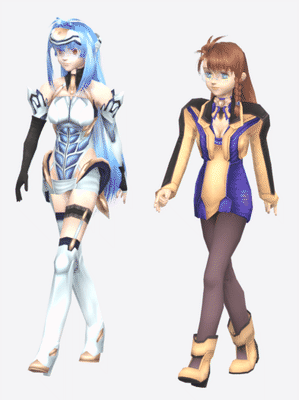

# Motion

Episode I's animation is decoded. Every clip on the disc is read to its last
byte, and a clip made for a skeleton becomes a glTF animation on the armature
the kit already writes for that model: one Blender action per clip, 30 keys a
second.



```sh
python cli.py extract --iso GAME.iso --out out/ --code          # once
python cli.py model  --dump out/dump --path 'char\pc\kosmos.lex' --out kosmos.glb
python cli.py model  --dump out/dump --path 'char\pc\kosmos.lex' --out kosmos.glb \
       --motion 'motion\kosmos_cf.fpk#1,3'                      # chosen pack, chosen slots
python cli.py motion --dump out/dump --pack 'motion\kosmos_cf.fpk'   # what is in a pack
python cli.py motion --dump out/dump --sweep                    # read every clip on the disc
python cli.py browse --out out/ --kinds models                  # every model, with its motion
```

Nothing here has been compared with the running game. What "plausible" rests
on is listed under [What was checked](#what-was-checked).

## Where the format comes from

The USA executable keeps its function names, so the format was read from the
code that plays it and not guessed from the files. The functions, by the
executable's own names:

| Function | What it settled |
|---|---|
| `FCV2_resetPack` | the clip header, the time scale, where the keys start |
| `FCV2_readAttribute` | the records before the keys: skeleton name, frame ranges |
| `FCV2_getPackAttribute` | the record that starts each skeleton block's keys |
| `FCV2_getPackValue`, `FCV2_getPackVal` | a curve: nothing, a constant, or keys; the five key types and how each is interpolated |
| `JNT_computeMatrix` (0x314a38) | the routine that poses every character (`ACT_resetAnimation` registers it for each actor), and the order: the body blocks from the clip, then hair and cloth, then the rest |
| `JNT_getVal` (0x30f038), `JNT_constructMatrix` (0x30f938) | which values each `.jnt` block type reads, how they become a matrix, and the chain solver |
| `JNT_getStaticVal` | what a block does when the clip has nothing for it |
| `CUR_MATRIX_*`, `alignXAxis` | the matrix operations those use |
| `ACT_setRelation`, `JC_face` | a face model follows block 48 of the body |

## Packs and clips

Motion lives in `.fpk` files: 248 on the USA disc (176 in `motion\`, the
field and battle sets; 65 in `mtnpack\`, one per cutscene; 7 in `nisimori\`,
weapons and mechs).

**`FPK`**: `FPK\0`, u16 version (3), u32 slot count at +8, then one u32 offset
per slot from +0x10, and one u32 per slot after that (1 or 2; not
interpreted). Several slots can point at the same clip: `kosmos_cf.fpk` has 32
slots and 31 clips, slots 0 and 30 sharing one.

**`FCV`** clip, all little-endian:

| Offset | | |
|---|---|---|
| 0 | `FCV\0` | |
| 4 | u16 | format (3 on every clip of the disc) |
| 6 | u16 | frame count the key times are a fraction of |
| 8 | u16 | first frame played |
| 10 | u16 | last frame played |
| 12 | s16 | frame offset added to the playing time |
| 16 | u32 | byte size of the attribute stream that starts here |
| 20 | | attribute records: u16 size, u16 type, payload |

Attribute type 1 is the name of the skeleton the clip was made for (8 bytes,
`KOSMOS`; the game keeps only a key made from it, see **Which clips a model
gets** below); type 2 is a frame range: u8 selector, s8 speed in 1/32, u16
first frame, u16 last frame. The selector's low seven bits name the
attribute index it applies to. With bit 7 set it is a play range: it
replaces the clip's first and last frame and its speed. With bit 7 clear it
is a reset range, the frames a looping clip restarts in, and its speed byte
is not used. All 439 type-2 records on the disc have selector 0, so all are
reset ranges; `motion --pack` lists each as `reset range 10-39` (or `play
range` when bit 7 is set). The key stream starts where the attribute stream
ends.

The key stream is one record per skeleton block, in `.jnt` block order:

```
u16 size (4 or 12)   u16 type (4)
u16 flags            u16 value mask
[u16 translation link, u16 pivot link, u16 rotation link, u16 0]   only when size is 12
one curve per set bit of the value mask
```

Mask bits 0-2 are translation x, y, z; 3-5 rotation about Z, Y, X (the same
triple and order as the `.jnt`); 6-8 scale. The root block's record (flag
0x8000) has one more value, a flag, after its scales. The game reads it
whenever bit 7 is set (`JNT_getVal` passes the mask shifted by 7 to
`get_fcvpack_flag`), not by bit 9, and the kit reads it the same way. The
disc's clips store it as bit 9: every root record on the disc has mask
0x3FF, bits 7 and 9 both set.
A record with flags 0xFFFF ends the clip (3,753 clips have one; the other 394
simply stop). So does any record that is not type 4: `FCV2_getPackAttribute`
then returns its default record (flags 0xFFFF) without moving on. Bytes after
an end are not read; the kit allows them, except in `motion --sweep`, which
checks that every clip is read to exactly its last byte.

A curve is `u16 key count, u16 flags`; the low four bits of the flags are the
kind (the upper bits, 0x8000 on many disc curves, are something else). By
kind: 0 nothing (the value is 0), 1 one float, 3 the keys. A key is `u16 type, u16 time, f32 value` and,
by type:

| Key type | Extra | Between this key and the next | On the disc |
|---|---|---|---|
| 0 | | straight line | 6,003 |
| 1 | f32 tangent in, f32 tangent out | cubic Hermite | 43,207 |
| 2 | | cubic Hermite, flat tangents | 439,508 |
| 3 | | holds its value | 226 |
| 4 | f32 tangent (both sides) | cubic Hermite | 1,280,679 |

A key's time in seconds is `time * frame count / 65535 / 30` from format 2 on
(every disc clip); below format 2 the game uses `last - first frame` instead of
the frame count and adds no frame offset. In the clip checked for it
(`kosmos_cf` slot 1, 467 keys) every key lands on a whole frame. Tangents are per second.

Every clip on the disc stores one curve per set mask bit, so a clip can be
read without its skeleton. That is how the sweep reads all 4,147. It is a
property of the disc's clips, not a rule of the game: the game reads only the
bits `JNT_getVal` consults for the block's `.jnt` type (table below). The kit
checks that the two agree for every body block before it poses a clip.

## From values to a pose

The values mean nothing without the `.jnt`, because the block's type decides
what is read and what it does:

| `.jnt` type | Reads | Matrix |
|---|---|---|
| 1 node (0 as well, among the body blocks) | translation, rotation, scale | parent · T · Rz·Ry·Rx · S. With link flags it can take its position (flag 4) or its rotation (flag 8) from another block instead. The blocks after hair and cloth go through `JNT_getVal2`, which leaves out S when the record has no link flags, keeps any scale component the record does not store from the block before, and reads nothing for type 0 |
| 3 chain root | translation, rotation | parent · T · R; starts a chain |
| 2 chain link | rotation (held inside the `.jnt`'s limits), scale | nothing yet: kept until the chain's end. Its translation is the `.jnt`'s, and the sign of the `.jnt` float at +0x38 picks which way a solved chain bends |
| 4 chain end | nothing | builds the whole chain |
| 5 node with scale | translation, rotation, scale | parent · T · R · S |
| 6 name | nothing | none |

A translation or rotation the clip leaves out comes from the `.jnt`; a scale
it leaves out is 1 (`get_fcvpack_fix`'s default; the `.jnt` has no scale),
except for the `JNT_getVal2` type-1 case in the table. A block past the
clip's last record keeps its `.jnt` translation and rotation.

**Chains.** At a chain's end the game either walks the links forward (each
link's translation, rotation and scale in turn) or, when the end's record has
flag 4 and names a target block, solves the chain toward that block's
position:

* two links and an end (a leg): the chain root is turned so its X axis points
  at the target, the first bone is bent by the angle the law of cosines gives
  for the two bone lengths and the distance, and the second bone is aimed at
  the target. With a pivot block (flag 2 on the first link) the bend plane is
  turned toward it first.
* one link and an end: the bone is aimed at the target and rolled by the
  link's X rotation.
* more links: the game has a general branch (law-of-cosines bends on the
  middle links). The kit does not port it and reports such a clip as not
  posable. No clip on the disc solves a chain of more than two links, and
  the branch has quirks no data could check: it never writes the first
  link's matrix, and it translates by the element of the absolute block
  index rather than the chain's.

On KOS-MOS, Shion, Ziggy, MOMO, chaos and Jr. the two legs are solved at every
frame of every field clip, toward two target blocks near the feet that the
clip keys directly; the ankle then takes its rotation from another keyed
block. That is why a leg cannot be exported by copying rotations: the clip
does not store the thigh's or shin's.

In the two-link case without a pivot, `JNT_constructMatrix` turns the aimed
chain root by the first link's X rotation and applies that link's scale
before it bends the first bone (0x310158 to 0x310168). `JNT_getVal2`, which
the game uses for other blocks (see **Hair and cloth** below), has the same
branch but reloads the unturned matrix afterwards (0x311798 to 0x3117a8).
A character's legs go through the first one, and so do the kit's.

**The root.** Every clip on the disc has exactly one block with flag 0x8000,
always with mask 0x3FF. `JNT_computeMatrix` sets block 0 to the identity,
reads the records up to this one, and builds blocks 1 to it: block 0 is never
built from the clip, whatever its record keys, and at the end it is replaced
by the actor's own matrix. The root block's position is handed to the actor
as the character's movement. `JNT_constructMatrix` then rescales the root
block's height (when it is block 4 or later) by the ratio of the previous
block's `.jnt` Y translation to that block's posed height, and moves the
block back onto its parent when the actor's channel mask has its
translation bits clear (`& 7 == 0`, travel masked off). That last step does
not happen with the channel mask characters start with (0x1FF). The kit keeps block 0 at the identity and rescales the root
block's height the same way, and does not move the block back: a clip that
travels (a jump, a step back) travels in the exported action.

**Hair and cloth.** `JNT_computeMatrix` walks a `.jnt`'s blocks in four
ranges. On `kosmos.jnt` (170 blocks; 74 primary, 46 secondary):

| Blocks | On `kosmos.jnt` | What the game does |
|---|---|---|
| body: 0 to `JNT_hairID` | 0-94 | reads one clip record per block (`JNT_getVal`) |
| hair and cloth: `JNT_hairID` to primary + secondary | 95-119 | simulates them (`EXM_CalcExMotion`), reading no record |
| the next additional_primary_count blocks | 120-151 (all name blocks, type 6) | `JNT_getVal2`, reading on from the record after the body's |
| the rest | 152-169 | `.jnt` values (`JNT_getStaticVal2`) |

`JNT_hairID` is the primary count, plus the secondary count when the `.jnt`
has no type-5 attribute record, plus the type-5 tag's low half when its kind
is 0x8A. `kosmos.jnt`'s tag is 0x8A0015, so its body is 74 + 21 = 95 blocks.
660 of the 760 `.jnt` files on the disc have no hair-and-cloth range at all
(the body ends at primary + secondary).

In normal play the hair range is simulated; the game takes those blocks
from the clip (`JNT_getVal2`) only when the actor's animation flags have bit
31 set, and leaves them at their `.jnt` values when bit 30 is set or the
actor has no matrix buffer. Because the simulation reads no record, the
first `JNT_getVal2` block reads the record right after the body's, not the
one stored at its own index; it stops being meaningful at the first record
its block type does not read (the game reads on out of step there; the kit
stops and leaves the rest static). 30 of the 31 `kosmos_cf` clips have
exactly 95 records, one per body block; the other has 127, whose records 95
to 126 store nothing and go to the name blocks 120-151, which have no
matrix. So nothing after the body is driven on KOS-MOS. Blocks after
additional_primary_count are static whatever the clip stores.

The kit runs the hair and cloth chains through a port of `EXM_CalcExMotion`
(exm_1.c) two ticks a frame. The port follows the per-name types and
collision tables of `EXM_PresetHair`, gravity, the pull back toward the
stiff chain, link length, the floor, the sphere and capsule collision
(`EXM_CheckExCollision`), the skirt collision (`EXM_CheckSkirtCollision`),
Jr.'s coat width (`AdjustJrCoatWidth`), the bend of the ALT_SHAPES flag and
the turn of each link toward the next (`OrientExMotionJoint`). Before the frames are
taken the chains settle for 120 ticks on the first frame, and a clip that
ends where it started is played through once first. Wind (off by default)
and the hip sway (set only by hair_test.c) are not followed. A skeleton whose name
`EXM_PresetHair` does not know gets type 0 for every chain (in the game it
would keep whatever an earlier skeleton left there). On KOS-MOS the back
hair (`33_kosmos_hair`, weighted to the head and to chain 95-100) gets
type 3 with ALT_SHAPES and collides with two spheres on her back. Leaving
it at rest was what buried it inside her back in the run: the rest pose
welds it to the head, and the run tips her head back about 35 degrees
against her chest.

Skirts, dresses and long coats are chains of a skirt type: instead of the
collision tables, each joint is kept out of the cone the two legs sweep
(thigh to knee, thigh to shin, and on long coats blocks 54/66 down to
60/72). It is measured from block 11 across and block 13 up, along the way
block 36 faces (block 14 for the split skirt `BOSS030` uses). Each type
sets which way the joint is pushed (front, back, a side or a corner), and
the skeleton's name sets how wide the cone is. A hem lift keeps the front
or back corners above the knees. On Jr. the coat used to hang at rest
while his legs walked through it. Now it swings clear: the closest a coat
joint comes to his legs in field clip 2 goes from 1.8 cm to 5.5 cm. The
formula takes positions relative to block 11, so on a skeleton whose block
11 is far from its legs the push is far off too: in `BOSS030`'s clips its
legs move up to about 16 m from block 11, and skirt joints are thrown
about as far. The game runs the
same arithmetic on the same blocks, but this has not been checked in the
running game.

## What the kit writes

`fcv.bake` poses every frame from first to last (through `fcv.simulate`
when the skeleton has hair and cloth chains) and writes, per block the
clip drives and per block the simulation moves, its translation,
rotation and scale relative to its parent block. The keys are the pose at each 30 Hz frame and match the game only at
those instants: glTF interpolates linearly between them, so a step key (type
3, 226 on the disc, all in the cutscene packs of `mtnpack\`) ramps over one frame instead of
jumping, and a Hermite segment is followed frame by frame. Then:

* a track that never leaves the rest pose is not written, and one that holds
  a single value is written as two keys;
* a block with no skinned joint at or below it is not keyed. These are the
  foot targets and their like: they move no vertex, and Blender would import
  each as an empty with an action slot of its own;
* the animation is named `<pack>#<slots>` (`motion/kosmos_cf#01`), with the
  clip's frame range, offset, frame ranges and the number of chains solved
  per frame in its `extras`;
* a block that some clip scales unevenly, with a child turned against that
  scale, cannot be held as a translation, rotation and scale under its
  parent: the game keeps scale on the right of the rotation (R_parent · R ·
  diag(s)), glTF puts the parent's scale between them. When a clip does that
  (some boss and cutscene clips, e.g. `boss_017`, `guno_013`; no party
  clip), the blocks under the scaled one are hung straight off the
  `skeleton` node and keyed in skeleton space in every animation of that
  file, which the game's matrices always fit exactly. The `extras` then
  carry `skeleton_space_blocks`.

Which clips a model gets:

* `browse` and `model` without `--motion`: every clip in a `motion\` pack
  made for the model's skeleton whose records line up with its blocks (no
  more records than blocks, and no body record storing a value `JNT_getVal`
  would not read for that block's type). "Made for" is the game's own test:
  `FCV2_readAttribute` and `JNT_readAttribute` turn the 8-byte name field
  into a 32-bit key (u32 word 0 · 31 + u32 word 1, 0 when there is no name),
  and `JNT_computeMatrix` takes the `JNT_getVal` path when the two keys are
  equal. The kit pairs by that key. On the USA disc it gives exactly the
  pairs comparing the names would. The 89 unnamed clips (key 0) would
  key-match the 9 skeletons without a name (key 0) in the game; the kit
  does not attach them.
  `kosmos.lex` gets 37 animations this way, `ziggy.lex` 96. Over the whole
  USA disc (`browse --kinds models`, measured after the hair and
  skeleton-space changes) 171 of the 1,317 models get motion, 2,611 actions
  and 179,317 frames in all, about 74 MB of animation data in an 816 MB
  models folder. The whole models pass took 26 minutes on this
  Mac, most of it the hair simulation; the motion's share was not timed
  separately.
* `model --motion PACK[#SLOTS]`: the clips you name (a slot the pack does
  not have is an error, and the command fails if a named clip could not be
  written; the `.glb` still gets the others). A clip made for another
  skeleton is written if its records line up, and its name says so
  (`motion/shion_cf#01 [made for SHION]` on `shion.lex`, whose skeleton calls
  itself `SHION_3`). In the game such a pair goes through a second routine
  (`JNT_getVal_staticChain`) that the kit does not follow; among other
  things it keeps the skeleton's own translation on chain roots even where
  the clip stores one. Treat these as less certain than a same-name pair.

The cutscene packs in `mtnpack\` are not attached by default: one pack holds
every character of a scene, and a character's clips from all scenes together
would be hundreds. Name the pack with `--motion` to get them.

**Faces.** A face model is a second actor that the game hangs on block 48 of
the body (`ACT_JOINT_HEAD`), copying that block's matrix into the face's
skeleton every frame. The kit merges faces into their bodies, so in the
`.glb` each face weight group is a small bone under block 48 and the face
follows the head as one piece. Eyes and mouths do not animate.

## What was checked

| Check | Result |
|---|---|
| Every clip of every `.fpk` reads to exactly its last byte (`motion --sweep`) | 4,147 of 4,147 on the USA disc, 4,147 of 4,147 on *Reloaded* (Japan) |
| Keys read | 1,769,623 over 710,304 frames |
| Clips paired with a skeleton of their key, body records lining up | 3,833 clips; 6,876 clip-skeleton pairs (a clip can fit several `.jnt` of one name) |
| Every pair posed at its clip's first, middle and last frame, every matrix number (rotation, scale, position) finite | 6,876 of 6,876 |
| Not paired | 314: 89 carry no name, 134 name a skeleton no `.jnt` has (`MATHEWS`, `RW_M`, weapon rigs), 91 name one but their body records do not line up with it |
| Party field packs, every frame (`self-test --iso`) | 184 clips, 11,684 frames, 23,368 leg chains solved (exactly two a frame); the 21,051 that are unscaled and within reach land within 1e-15 m of their target (worst 7.1e-16 m); the other 2,317 are scaled by the clip or out of reach and are not measured |
| The `.glb` read back | every skinned block's matrix composed from the written keys equals the posed one (axes and origin) to 5e-7, at six frames each of `kosmos_cf` #03 (simulated hair included) and `guno_013` #29 (skeleton-space blocks); before those blocks were hung off the skeleton node, `guno_013` was off by up to 1.5 |
| Khronos glTF validator 2.0.0-dev.3.10 on `kosmos.glb`, `jr.glb`, `ziggy.glb` (96 actions) and `shion.glb` | no errors, no warnings, on an earlier build whose `kosmos.glb` had 36 actions; the current one has 37 and has not been through the validator again |
| Blender 5.4 (background) | imports each action at its clip's frame range. Renders looked at before the leg-roll and hair changes: KOS-MOS (walk, run, a jump and landing, an arm gesture, a turn), Shion, chaos, MOMO, Jr. and Ziggy (walk): feet on the ground, knees bending forward, arms swinging opposite the legs, nothing detached. After them: KOS-MOS walk and run from the back, front and side (the back hair hangs behind her in every frame), Shion and MOMO (walk, run), `boss_017` and `guno_013` with the skeleton-space blocks |

The clips have no names on the disc beyond their slot numbers, so "walk",
"run" and "jump" describe what the renders look like.

## What is not done

* **No comparison with the running game.** The pose matches the path the
  decomp shows the game taking for a character (`JNT_computeMatrix`, then
  `JNT_getVal` and `JNT_constructMatrix`), but poses, timing and the
  playback rate have not been compared with the running game in PCSX2.
  `docs/research/pine_pose.py` reads the engine's matrix table and would be
  the way to do it.
* **Hair and cloth are simulated, without wind.** See **Hair and cloth**
  above. The simulation, skirts included, has not been compared with the
  running game.
* **Faces do not animate.** No clip was found that drives a face skeleton's
  eyes or mouth, and the kit did not look for where the game does it.
* **Clips for another skeleton** are read but only posed when asked for by
  name, as above; 91 same-name clips whose body records do not line up are
  left out.
* **Chains of more than two links solved toward a target** are not posed
  (see **Chains**); no disc clip has one.
* **Between frames.** The actions are sampled at the 30 Hz frames; see
  **What the kit writes**.
* **Blending** between two clips (`JNT_interpolate`) and the frame ranges
  (type-2 records) are not applied: an action plays its clip's frames once,
  first to last.
* **Cameras.** The cutscene cameras use the same curve reader
  (`tcamera.c`); the kit does not export them.
* **Motion on a model with a captured pose.** If a `.pose.json` sits beside
  the `.jnt` the model is written in that pose and gets no motion.

## Remaking the front-page pictures

```sh
python cli.py model --dump out/dump --path 'char\pc\kosmos.lex' --out kosmos.glb \
       --motion 'motion\kosmos_cf.fpk#0,1,3'
python cli.py model --dump out/dump --path 'char\pc\shion.lex' --out shion.glb \
       --motion 'motion\shion_cf.fpk#1'
blender -b --factory-startup --python docs/gallery/render_motion.py -- walk 14 \
       'kosmos.glb=motion/kosmos_cf#01' 'shion.glb=motion/shion_cf#01' --size 560 560
python docs/gallery/make_gif.py walk docs/images/front/motion-kosmos-shion-walk.gif --height 400 --ms 66
blender -b --factory-startup --python docs/gallery/render_motion.py -- run 11 \
       'kosmos.glb=motion/kosmos_cf#03' --size 480 560 --fit-all --cam 40 8
python docs/gallery/make_gif.py run docs/images/front/motion-kosmos-run.gif --height 400 --ms 66
blender -b --factory-startup --python docs/gallery/render_motion.py -- turn 36 \
       'kosmos.glb=motion/kosmos_cf#00' --size 420 560 --turntable
python docs/gallery/make_gif.py turn docs/images/front/kosmos-turntable.gif --height 400 --ms 83
python cli.py model --dump out/dump --path 'char\pc\jr.lex' --out jr.glb \
       --motion 'motion\jr_cf.fpk#1,3'
blender -b --factory-startup --python docs/gallery/render_motion.py -- jrrun 10 \
       'jr.glb=motion/jr_cf#03' --size 480 560 --fit-all --cam 60 8
python docs/gallery/make_gif.py jrrun docs/images/front/motion-jr-run.gif --height 400 --ms 66
blender -b --factory-startup --python docs/gallery/render_motion.py -- jrwalk 13 \
       'jr.glb=motion/jr_cf#01' --size 480 560 --fit-all --cam 60 8
python docs/gallery/make_gif.py jrwalk docs/images/front/motion-jr-walk.gif --height 400 --ms 66
```

Jr.'s two GIFs (the run on the front page, the walk in
[BLENDER.md](BLENDER.md#a-moving-model-step-by-step)) were made with the
skirt collision.

`render_motion.py` runs inside Blender; `make_gif.py` needs Pillow. Neither is
part of the kit's own requirements.
