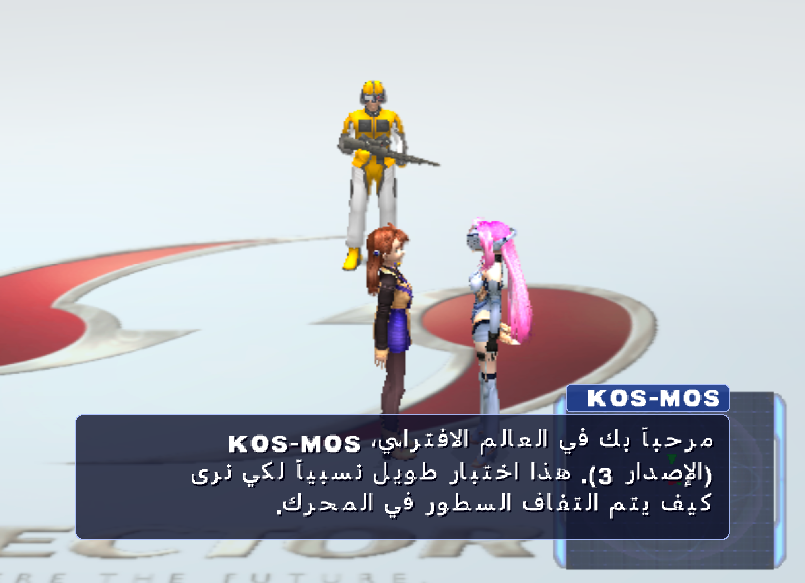
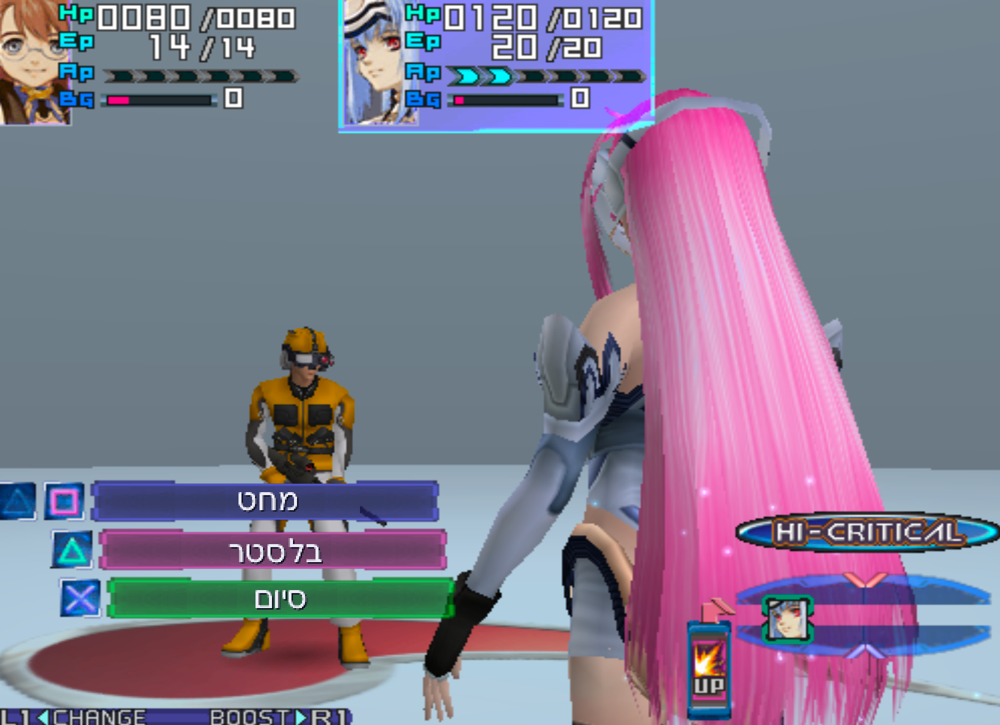
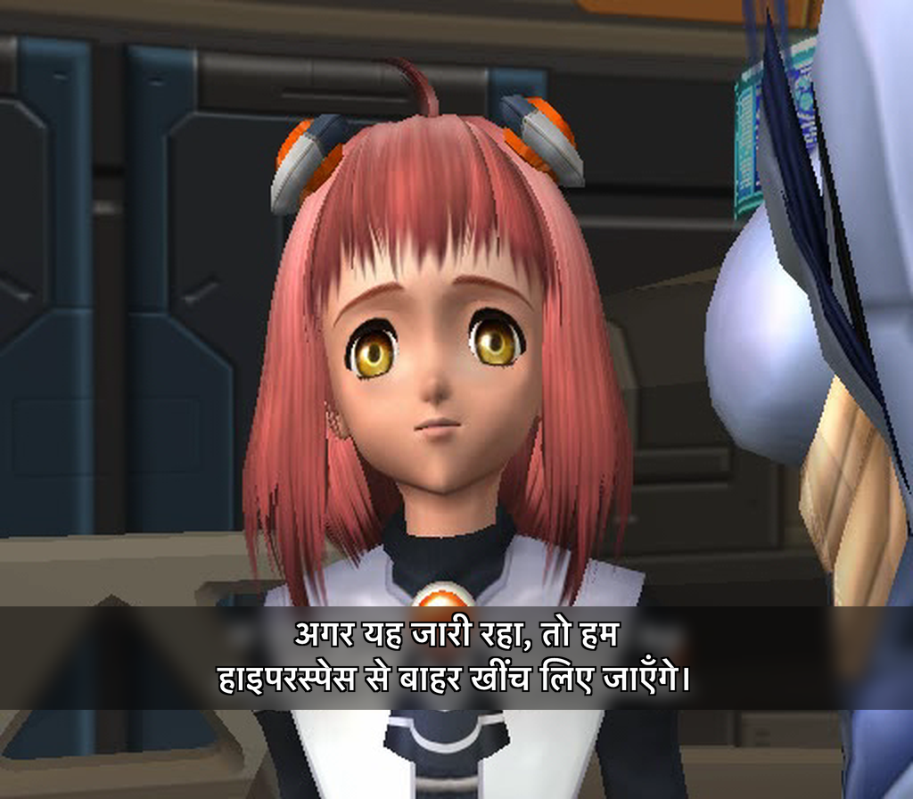
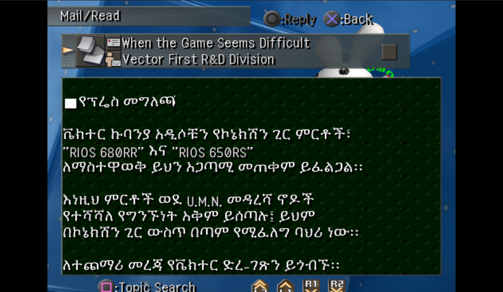

# Translating into another alphabet: Arabic, Hebrew, Hindi, and the rest

The game draws text one cell at a time, left to right, from a bitmap font
that knows Japanese and Latin. Everything a different script needs —
letters the font never had, joining forms, right-to-left order, conjuncts
— is done at build time by the kit, and the game only ever sees a stream
of glyph codes. This is the usual way console fan translations handle
these scripts; the kit packages it so the whole trip is five commands.

What you need: the retail ISO, a TrueType/OpenType font for your script
(any free one works: Amiri or Noto Naskh Arabic, Noto Sans Hebrew,
Noto Sans Devanagari…), Python, and two optional packages for the
TrueType path:

```sh
pip install fonttools uharfbuzz
```

(Without them you can still draw cells by hand in a PNG sheet — see the
end of this page.)

## What it looks like

Mock-ups, not captures: the text is drawn from the kit's rebuilt font
cells (`font.py` + `langpack.render_line`, the same layout rule the
printer uses) and composited onto real screenshots and a real cutscene
frame. The in-game boot is still yours to take.

| | |
|---|---|
|  |  |



Dialogue and menu text go through the game's font, exactly as `encode`
emits them. Cutscene subtitles are different: the movies carry their
English **burned into the picture**, so a subtitle pass has to cover it
(a blurred plate, as above and as XS1KOR did) and burn the new line
with `subs-burn`, which shapes any script through libass — the Hindi line
here was shaped with HarfBuzz and drawn from Kohinoor Devanagari, which
is what libass would do with the same font.

## 1. Export the text

```sh
python cli.py text-export --iso GAME.iso --out tr/text        # menus, chats, mails
python cli.py evt-export  --iso GAME.iso --out tr/dialogue    # cutscene + field dialogue
```

Both trees are plain UTF-8. Dialogue files hold one string per line,
`@class.index<TAB>text`; translate the text after the tab and leave the
key. Keep every `⟦XX⟧` marker where it is: those are control codes
(colour, pause, name boxes) the engine reads in logical order. The
Japanese debug prints you will see in the scripts can stay as they are —
the encoder leaves the disc's own Japanese alone.

Write the translation in **logical order**, the way you type it. Do not
reverse anything, do not insert presentation forms, do not pre-wrap
except where the original had line breaks you want to keep.

## 2. Build the glyphs

```sh
python cli.py lang scan --iso GAME.iso --text tr --font Amiri-Regular.ttf \
    --script Arab --language ar --rtl --out tr/font
```

`scan` shapes every string in the tree with HarfBuzz, collects the glyphs
the translation actually uses (joined forms, ligatures, conjuncts, marks
drawn together with their base), gives each one a cell in the game's
font and draws it from your TrueType font into both faces. It writes:

* `glyphset.json` — which glyph got which code; keep it with the project
  so later runs reuse the same codes.
* `font0.tex`, `font1.tex` — the rebuilt fonts, plus `*_preview.png` of
  the sheet that holds the new cells.
* `langpack.json` — the options you used, so `encode` does not need them.

Where the glyphs go: the game has a 256-slot **proportional** block for
Latin text, each slot with its own width. The slots English needs
(digits, A-Z, a-z, space, punctuation — 95 of them) stay; the other 161
are yours. If your translation uses no Latin letters at all, add
`--reclaim-latin` for 213. Glyphs that do not fit, or overflow, go to the
2,992 **kanji cells**, drawn 20 px wide — fine for scripts with
near-uniform letter widths, visibly spaced for Arabic.

Size: `--px 20` (the em size in pixels) suits most fonts in the 24 px
cell; Devanagari with stacked marks may prefer `--px 17 --baseline 16`.
Look at the preview sheet and adjust. Glyphs wider than 18 px are
clipped in the proportional block; `scan` prints how many went to kanji
cells and which words used characters your font lacks.

Scripts tags are HarfBuzz/ISO 15924: `Arab`, `Hebr`, `Deva`, `Beng`,
`Thai`, `Cyrl`, `Grek`, `Geor`, `Armn`… `--rtl` for Arabic, Hebrew,
Syriac, Thaana.

## 3. Encode the text

```sh
python cli.py lang encode --text tr --glyphset tr/font/glyphset.json \
    --out tr-enc --width 400 --align right
```

For every string, `encode` shapes each word again, measures it with the
new metrics, wraps to `--width` pixels (0 = only your own line breaks),
puts the words of right-to-left lines in visual order (Latin names and
numbers stay forward, brackets are mirrored, a line that is entirely
Latin stays left-to-right), optionally pads lines to the right edge, and
writes the glyphs as `⟦XX⟧⟦YY⟧` codes. The output tree has the same
layout as the input, so the importers take it unchanged.

Pixel widths: the dialogue box is about 400 px wide at the proportional
size; mails use a fixed 10 px pitch. When in doubt, measure a long
retail line: `langpack preview` prints the encoded bytes and
`font.Font.width_of_bytes` measures any string. Lines that are too wide
are not an error here — the engine wraps them itself, in the wrong place
for right-to-left text, which is exactly what `--width` prevents.

Check a line before you touch the disc:

```sh
python cli.py lang preview --glyphset tr/font/glyphset.json \
    --text "مرحباً بك في العالم الافتراضي، KOS-MOS (الإصدار 3)." --out line.png
```

That renders the line from the rebuilt cells the way the printer lays
them out.

## 4. Write the ISO

```sh
python cli.py text-import --iso GAME.iso --text tr-enc/text     --out AR.iso --grow
python cli.py evt-import  --iso AR.iso   --text tr-enc/dialogue --out AR.iso --grow
python cli.py patch --iso AR.iso --out AR.iso \
    --set chain0:font0.tex=tr/font/font0.tex --set chain0:font1.tex=tr/font/font1.tex
```

Each importer checks every file and writes nothing if any fails. Two
bytes per letter means most lines grow; `--grow` lets an object that no
longer fits its slot be relocated to the end of the image (about 78 MB
of growth stays burnable; emulators do not care). Omit it to be told
which files are over and by how much.

## 5. Boot it

The fastest check costs nothing: with PCSX2 fast boot, the USA disc
reaches the Encephalon tutorial's first dialogue box about a minute
after boot with no input — `scene\ST0210.evt`, the line that was
`"Virtual Tutorial"`. Translate that one line, build, boot, read. If the
letters join and read right-to-left there, the font block, the codes and
the direction handling are all proven at once; everything else is
content.

Things worth a look on the first full boot:

* **Auto line-feed.** The engine wraps proportional text itself when a
  line is too wide. For right-to-left text that break lands in the wrong
  place, so keep `--width` under the real box width.
* **Mails** draw every glyph at a fixed 10 px pitch (their text starts
  with the `⟦15⟧⟦02⟧⟦04⟧⟦07⟧` control that selects that mode). Arabic
  reads oddly at a fixed pitch; keep mail lines short or drop that
  control from the mail header line.
* **Menus and battle UI** are in the executable and overlays, not in
  these trees — see ARABIC-TRANSLATION-SPEC.md Tier C for the state of
  that.

## Worked example: the LANGTEST disc

A disc that carries several scripts at once, built on 2026-10-14 to see
the pipeline on the screen rather than in previews. It starts from the
pink-hair recolour ISO (so it doubles as a check that unrelated patches
coexist) and adds an Arabic cold-open line and an Amharic U.M.N. mail,
both drawn from the same rebuilt font files. Every step is a command
anyone can repeat; `tr/` is the working directory.

```sh
# 0. the base: a copy of an already-modded disc
cp "Xenosaga Episode I (PINK).iso" "Xenosaga Episode I (LANGTEST).iso"

# 1. the texts, in logical order, in two small trees (one script each)
python cli.py evt-export  --iso "…(USA).iso" --out tr/dialogue     # take ST0210.evt.txt, change one line
python cli.py text-export --iso "…(USA).iso" --out tr/text         # take umn/0000.uml.utf8.txt, rewrite it
#    tr/ar/chain0/scene/ST0210.evt.txt   @3.244z  "درس افتراضي"   (was "Virtual Tutorial")
#    tr/am/chain0/umn/0000.uml.utf8.txt  Subject/Sender lines + Amharic body, no ⟦15⟧⟦02⟧⟦04⟧⟦07⟧

# 2. glyphs, one scan per script, the second extending the first
python cli.py lang scan --iso "…(USA).iso" --text tr/ar --font SFArabic.ttf \
    --script Arab --language ar --rtl --out tr/font-ar
python cli.py lang scan --font0 tr/font-ar/font0.tex --font1 tr/font-ar/font1.tex \
    --extend tr/font-ar/glyphset.json --text tr/am --font KefaIII.ttf \
    --script Ethi --language am --px 18 --out tr/font-am
#    -> 8 Arabic + 73 Ethiopic glyphs in 81 proportional slots; 80 remain free

# 3. encode, each tree with its own glyphset
python cli.py lang encode --text tr/ar --glyphset tr/font-ar/glyphset.json --out tr/ar-enc
python cli.py lang encode --text tr/am --glyphset tr/font-am/glyphset.json --out tr/am-enc --width 400

# 4. write everything into the disc (the mail fits its slot; --grow is harmless)
python cli.py evt-import  --iso LANGTEST.iso --text tr/ar-enc --out LANGTEST.iso --grow
python cli.py text-import --iso LANGTEST.iso --text tr/am-enc --out LANGTEST.iso --grow
python cli.py patch --iso LANGTEST.iso --out LANGTEST.iso \
    --set chain0:font0.tex=tr/font-am/font0.tex --set chain0:font1.tex=tr/font-am/font1.tex
```

Notes from doing it:

* **Mails and the fixed pitch.** Retail mail bodies open with the
  control `⟦15⟧⟦02⟧⟦04⟧⟦07⟧`, which makes every glyph advance 10 px.
  The Amharic body simply leaves it out, so the viewer lays the text out
  proportionally like dialogue. The `Subject: ` and `Sender: ` labels and
  the `\r\x02` marker after `Subject: ` are kept exactly; the encoder
  passes raw control characters through like `⟦XX⟧` markers.
* **One disc, several fonts.** `--extend` keeps the slots the first scan
  gave out; `--font0/--font1` point the second scan at the first scan's
  output instead of the retail files. Each script is encoded with the
  glyphset that contains its glyphs (the later one contains both).
* **Scripts the font lacks** are reported by `scan` ("word uses
  characters this font lacks") rather than silently drawn as boxes;
  that is how the Hebrew word in an Arabic test tree showed up.
* **Patching a disc an emulator is running from** is a bad idea: the
  first boot of LANGTEST hung at the publisher logo after the fonts were
  rewritten underneath it. Finish the disc, then boot it.

Driving the emulator without touching the desktop: PCSX2 started with
`-nogui -fastboot -nofullscreen -batch LANGTEST.iso`, focus handed back
to the previous application, pad presses posted to PCSX2's PID with
Quartz (`CGEventPostToPid`, the Cioppinosaga `bg_input.py` method), the
window captured by id with `screencapture -l`. No keystroke or screenshot
touches the user's own windows.

**Results, 2026-10-14, PCSX2 v2.7.524 on the LANGTEST disc:**

| | |
|---|---|
|  |  |


* The first dialogue box of a New Game shows ``"درس افتراضي"`` joined and
  right-to-left, drawn by the game's own printer from the rebuilt
  `font0.tex`: raw two-byte codes in the proportional block take the same
  path as the ASCII table's output. That was the one open question.
* The first inbox mail on the Woglinde (savestate, `umn\0080.uml` re-written
  while the game was running, inbox re-opened) shows the Amharic body
  wrapped at 400 px with mixed Latin, Ethiopic punctuation and the ■
  bullet — proportional, because the body omits the fixed-pitch control.
  The subject/sender line stayed English: the mail list is cached in RAM
  when the save is loaded, so only the body was re-read from disc.
* Not exercised by this disc: relocation past the image end (both
  objects fit their slots). The scratch build that relocates ST0210 reads
  back correctly through the TOC but has not been booted.

Driving notes that cost time, so you do not pay them again: PCSX2 pad
keys need a **~300 ms hold** when posted by PID (80-90 ms taps are
ignored at the title even though hotkeys like F8 register); Circle is
confirm; the field menu will not open while standing on a ladder; the
`-nogui` launch is fine for captures but was not needed.


## Hand-drawn cells instead of a TrueType font

If you would rather draw the letters yourself, or have no shaping
packages: make a PNG whose width is a multiple of 20 and height a
multiple of 24, one glyph per cell left-to-right, top-to-bottom, white
on black (grey levels are kept as the font's four shades), and a text
file with one key per line in the same order. Keys are the characters
(for Arabic, the presentation forms — the built-in table turns words into
them). Then:

```sh
python cli.py lang scan --iso GAME.iso --text tr --cells mycells.png --keys keys.txt --rtl --out tr/font
```

`encode` and the rest are unchanged. XS1KOR, the Korean localisation of
the Japanese disc, did it this way for 2,048 Hangul cells.

## Credits

The font files' GS layout and the fact that a TrueType face renders into
these cells and plays were first shown by poketony's
[XS1KOR](https://github.com/poketony/XS1KOR); the engine's cell
addressing, the proportional slot permutation and the width rule were
recovered from the USA executable for this kit, and the shaping,
ordering and encoding pipeline is the kit's own.
