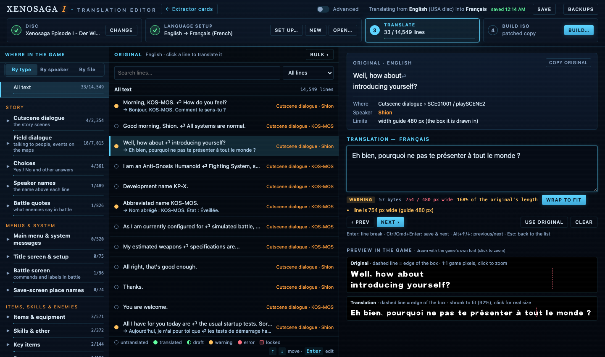
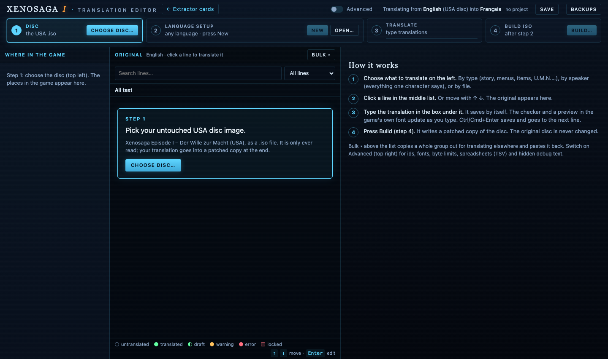
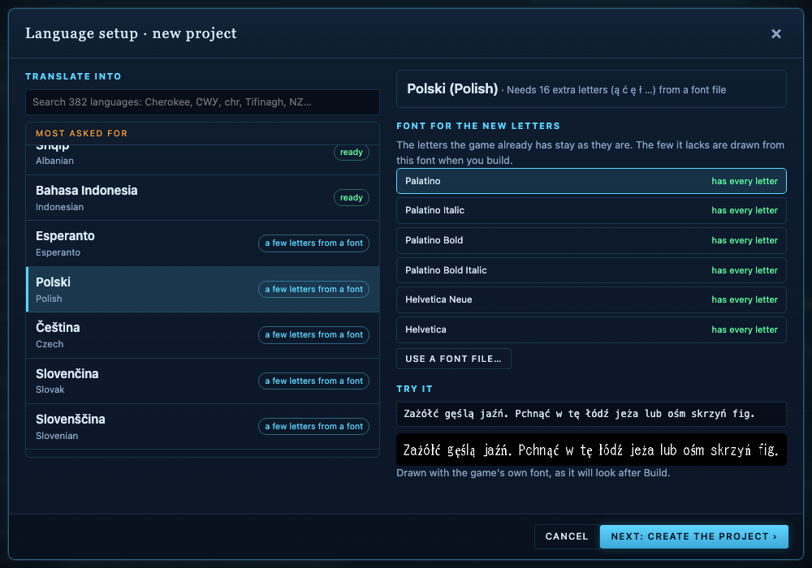
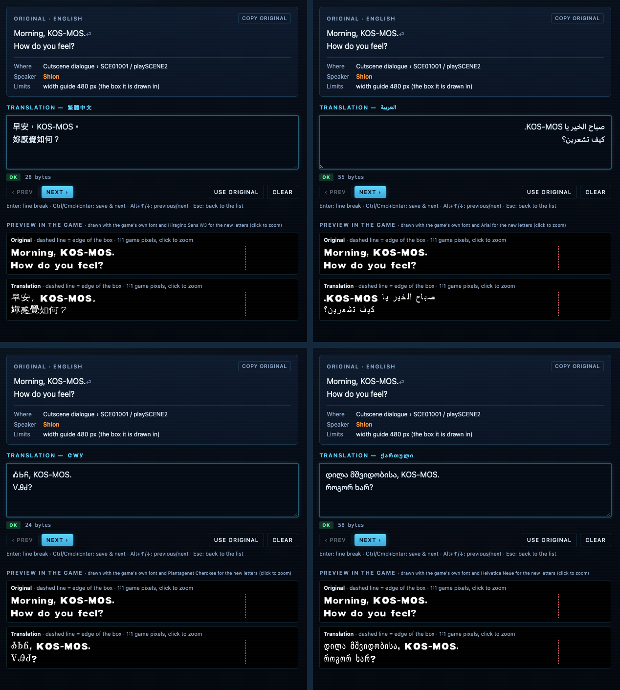

# Translate Xenosaga Episode I into your language

A beginner's guide to the translation editor. No programming needed. If
you can use a web browser and a spreadsheet, you can do this.

You type your translation next to the English text, the editor checks
each line as you go, and one button makes a new copy of the game disc
with your text in it. Your original disc image is never changed.

**In this guide**

1. [What you need](#1-what-you-need)
2. [Start the editor](#2-start-the-editor)
3. [The three files](#3-the-three-files)
4. [The four steps](#4-the-four-steps)
5. [Translating a line](#5-translating-a-line)
6. [How long can a line be?](#6-how-long-can-a-line-be)
7. [Codes you must keep](#7-codes-you-must-keep)
8. [Saving and backups](#8-saving-and-backups)
9. [Build and test your disc](#9-build-and-test-your-disc)
10. [Working faster](#10-working-faster)
11. [Languages with other alphabets](#11-languages-with-other-alphabets)
12. [Good habits](#12-good-habits)
13. [When something goes wrong](#13-when-something-goes-wrong)
14. [Words used in this guide](#14-words-used-in-this-guide)

The full reference, with every detail, is
[TRANSLATION-EDITOR.md](TRANSLATION-EDITOR.md). Read this guide first.

---

## 1. What you need

| | |
|---|---|
| **The game** | Your own disc image of *Xenosaga Episode I: Der Wille zur Macht*, **USA version** (SLUS-20469), as one `.iso` file of about 8 GB. It must be an untouched copy. The kit contains no game data. |
| **A computer** | Windows, macOS or Linux. |
| **Python** | Version 3.9 or newer, from [python.org](https://www.python.org/downloads/). On Windows, tick **Add Python to PATH** in the installer. |
| **Free disk space** | About 9 GB for each disc you build. (On a Mac, building next to the original image takes almost no space.) |
| **An emulator** | [PCSX2](https://pcsx2.net/), to look at your translation in the game. |
| **Internet, once** | The first start downloads three small helper packages. |

## 2. Start the editor

1. Get the kit. On the kit's GitHub page press the green **Code** button,
   then **Download ZIP**, and unpack it. (The translation editor is newer
   than the ready-made app on the Releases page, so use the ZIP for now.
   From the next release, the app download will contain a **Xenosaga I
   Translation Editor** icon to double-click, with nothing to install.)
2. Open the kit's folder and double-click the translation launcher for
   your system:

   | System | Double-click |
   |---|---|
   | Windows | `translate.bat` |
   | macOS | `translate.command` (first time: right-click, then **Open**) |
   | Linux | `translate.sh` |

3. A black text window opens, and then the translation editor opens in
   your web browser. **Leave the text window open** while you work. It
   is the program; the browser page is only its screen. The first start
   takes a minute because it installs its helper packages.

You do not need the rest of the kit (unpacking the disc, textures,
models, music) to translate. If you want it, the `launch` files next to
the `translate` ones open the whole extractor, and its **Translation
editor** button leads to this same page.

To come back another day, double-click the translation launcher again.
The editor remembers your disc and your project. (If it ever opens
empty, pick the disc again and use **Open…** in step 2 to load your
project file; nothing is lost.)

## 3. The three files

It helps to know which file is which before you start.

| File | Example name | What it is |
|---|---|---|
| **The original disc** | `Xenosaga Episode I (USA).iso` | Your untouched game. The editor only reads it. |
| **The project** | `Xenosaga Episode I (USA) (FR).json` | Your translation. A small text file holding only what you typed. **This is the file to protect and back up.** |
| **The built disc** | `Xenosaga Episode I (USA) (FR).iso` | The game with your translation. You can delete it and build it again at any time from the two files above. |

One project holds one language. For a second language, make a second
project.

## 4. The four steps

The top of the page always shows four numbered steps. The one to do next
is lit.

### Step 1: Disc

Click **Choose disc…** and pick your untouched USA `.iso`. The editor
lists the images it finds on your computer; you can also browse to the
file or paste its path. The first time, reading the disc takes about ten
seconds.

Always pick the original, never a disc you built earlier. Every build
starts again from the original.

### Step 2: Language setup

Click **New**. Pick your language from the list (you can search by its
English name or its own name). Each language shows one of three labels:

| Label | Meaning |
|---|---|
| **ready** | The game's own font already has every letter you need. Nothing else to do. French, Spanish, German, Italian, Portuguese and many more. |
| **a few letters from a font** | The game lacks a few letters (for example Polish ą ę ł). The editor draws them from a font on your computer. |
| **new script · font** | The game has none of the letters (Russian, Greek, Arabic, Hindi, Chinese…). The editor draws all of them from a font on your computer. |

When a font is needed, the editor lists the fonts on your computer that
have every letter and picks one for you. The **Try it** box shows a
sentence drawn the way the game will draw it.

If your language is not in the list, choose **My language isn't listed**
and paste a sentence written in it.

Then press **Next: create the project** and choose where to keep the
project file. The suggested place, next to the disc, is fine.

**The language is locked once you have translated a line.** If you open
Set up… later you can still change the font, but not the language. To
translate into another language, press **New** and make a separate
project. (If you picked the wrong variant by mistake, such as Portuguese
instead of Brazilian Portuguese, switch **Advanced** on at the top right:
the setup then offers to change it anyway and makes a backup first.)

### Step 3: Translate

This is where you spend your time. See the next section.

### Step 4: Build ISO

Makes the playable disc. See [section 9](#9-build-and-test-your-disc).

## 5. Translating a line

The page has three columns.

* **Left: where in the game.** Story, menus, items, the in-game e-mail
  and so on. Click a group to open it. The numbers show how many lines
  are done, for example `6/2,354`. You can also list the lines **By
  speaker**, to do everything one character says.
* **Middle: the English lines.** Click one. Your translation, once you
  have typed it, appears under the English with an arrow.
* **Right: the line you are working on.** The English at the top, then
  the box where you type, then a picture of both drawn with the game's
  real font.

Type your translation in the box. Use your normal keyboard: accents,
ñ, ç, « », ¿ and ¡ all work, and the editor stores them the way the game
needs.

| Key | What it does |
|---|---|
| **Enter** | Starts a new line inside the text box |
| **Ctrl+Enter** (Mac: **Cmd+Enter**) | Finished, go to the next line |
| **Alt+↑ / Alt+↓** | Previous / next line |
| **Esc** | Back to the list |
| **↑ / ↓**, then **Enter** | In the list: move, then start typing |

Every line in the list has a coloured dot:

| Dot | Meaning |
|---|---|
| ○ empty | Not translated yet |
| ● green | Translated, no problems |
| ◐ half | A draft filled in for you (see [Working faster](#10-working-faster)) |
| ● orange | Translated, with a **warning**. The disc can still be built. Read the warning. |
| ● red | Translated, with an **error**. The disc cannot be built until you fix it. |
| ▢ locked | Not for translating. Changing it would break the game. |

Use the search box above the list to find any line by a word in it, and
the drop-down next to it to show only untranslated lines, or only lines
with problems.

## 6. How long can a line be?

Translations are usually longer than the English. The game's text boxes
have a fixed size on screen, so under the box the editor shows numbers
that tell you how you are doing:

| You see | Meaning | What to do |
|---|---|---|
| `38 bytes` | How much room the text takes on the disc. Most dialogue has no limit here. | Nothing. |
| `38 / 61 bytes` | This text has a **hard limit** (61 here). Going over is an **error**. | Shorten it until the number fits. |
| `394 / 480 px wide` | The width of your longest line, against the width of the box (480 here). | If it is over, press **Wrap to fit**. |
| `168% of the original's length` | How long your text is when drawn, next to the English. 100% is the same length. | Up to about 150% is normal. Much more: check that screen in the game. |

**Wrap to fit.** When a line is wider than its box, a **Wrap to fit**
button appears. It breaks the line at a space so each part fits. (Undo
with Ctrl+Z / Cmd+Z in the box.) You can also break lines yourself with
Enter, wherever it reads best.

**Too many lines.** If your text is longer than anything the original
game shows in that kind of box, the editor warns you: *"about 8 lines on
screen; no original text of this kind takes more than 6"*. This is a
warning, not a block, because the editor cannot see the screen. Shorten
the text, then look at it in the emulator.

Some facts worth knowing:

* **Story and field dialogue** can be any length on the disc, and the
  game wraps long field lines by itself. The limit is the box on screen.
  One message can never be more than 1,021 bytes (the editor stops you).
* **Names of items, skills and enemies** sit in narrow columns. The
  width shown is the widest English name in that list. Keep to it.
* **Save-screen place names, key items, plug-ins, casino text and enemy
  battle quotes** have hard limits. The editor shows the limit and will
  not build past it.
* **Battle screen words** use a small font with ten pixels per letter.
  Short is best.

The honest rule: the editor checks what can be measured, but **only the
game shows what really fits**. Look at long lines in the emulator.

## 7. Codes you must keep

Some lines contain codes that the game reads, not the player. The editor
shows them as small coloured chips in the English text. Your translation
must contain the same codes.

| Looks like | What it is |
|---|---|
| `/[color(0x3 0x4)]` … `/[color(0)]` | Start and end of coloured words |
| `/[$0]`, `/[waitkey]`, other `/[...]` | A name the game fills in, a pause, and so on |
| `%d`, `%s` | A number or a word the game fills in |
| `⟦0C⟧` and similar | A control code |
| `\15`, `\2` in chat lines | Chat formatting |

The easy way: press **Use original**. It copies the English into your
box, codes included. Then replace the English words around the codes
with your own. You may move a code to where it belongs in your sentence;
do not delete or change it. If one is missing, the editor tells you
which.

## 8. Saving and backups

* **It saves by itself**, a moment after every change. The top of the
  page says `saved` with the time. You can also press **Save** or Ctrl+S.
* If it ever says **save failed**, stop and read the message before you
  do anything else (see [section 13](#13-when-something-goes-wrong)).
* **Backups** (top right) keeps older copies of your project in a folder
  next to it, named `<project> backups`:
  * an **automatic** copy about every ten minutes while you work;
  * a **checkpoint** whenever you ask, with a name you choose, such as
    "End of chapter 1". Checkpoints are never deleted.
  * **Restore…** brings an old copy back. It first keeps a copy of how
    things are now, so you can undo a restore.
* These backups live on the same drive as the project. For real safety
  use **Save a copy elsewhere…** now and then, to a USB stick or a
  cloud folder.

## 9. Build and test your disc

1. Click **Build…** (step 4). A panel opens at the bottom.
2. Check the name of the new disc. The suggestion is fine.
3. Click **Build** and watch the log. It takes about fifteen seconds for
   a small project.

If any line has an error, nothing is built and the log lists the lines.
Click a line in the log to jump to it. Warnings do not stop a build.

When the build ends, the editor reads every translated line back out of
the new disc and compares it with what you typed, so you know the text
went in correctly. A build that fails leaves no half-made file behind.

**Then look at it in the game.** Open the new `.iso` in PCSX2 and visit
a few screens you translated. The editor proves the text is on the
disc; only the game shows how it looks. Build early and look often.
Don't wait until everything is translated.

To change something, fix it in the editor and build again. Tick
**replace if it exists** to reuse the same file name.

## 10. Working faster

**Translation memory.** Many lines repeat ("Yes", "No", item names).
When you finish a line, the editor copies your text to every untranslated
line with the same English, as a **draft** (half dot). Drafts are built
into the disc like any translation. Open one and press **Accept draft**
when you have checked it fits there too. You can turn this off in the
**Bulk** menu.

**Translate a whole group outside the editor.** In the **Bulk** menu:

1. **Copy group for translation** puts the untranslated lines of the
   open group on your clipboard, numbered: `[1] text`, `[2] text`… A `⏎`
   marks a line break.
2. Paste them into any other tool, translate, and keep the numbers.
3. **Paste translations into group** reads them back and shows each line
   before it is applied.

Paste back into the same group, **before** you translate other lines of
that group by hand. The numbers count the untranslated lines, so they
shift when you do.

**Spreadsheets.** With **Advanced** on, the Bulk menu can export the
whole project as a TSV file (open it in Excel, LibreOffice or Google
Sheets) and import it again. Each line carries its own id, so this is
the safest way for long work outside the editor.

## 11. Languages with other alphabets

The editor handles Cyrillic, Greek, Arabic, Hebrew, Hindi, Thai, Korean,
Chinese, Japanese and many more: 382 languages are listed.

* **You need a font file** on your computer that has your letters. The
  setup finds suitable ones. Free [Noto fonts](https://fonts.google.com/noto)
  cover almost every script.
* **Keep that font.** The project remembers where the font file is. If
  you move to another computer, install the same font there and pick it
  again in Set up….
* **Right-to-left languages** (Arabic, Hebrew, Persian…) are put in the
  right order when you build. A colour code in the *middle* of a
  right-to-left line is refused; put the coloured words on their own
  line.
* **The battle screen** uses a tiny font. Arabic letters cannot join
  there and complex characters look cramped.
* **Window titles** (the small ribbons) only have A–Z and 0–9.

**Movies** have no subtitle text to translate: the words are part of the
picture. They are handled separately; see [SUBTITLES.md](SUBTITLES.md).

## 12. Good habits

* **Make the project before you type.** Lines typed before a project
  exists live only in the browser tab and are lost if you reload.
* **Use one browser tab** for a project. Two tabs on the same project
  can overwrite each other's work on the same line.
* **Wait for `saved`** before you close the tab or switch projects.
* **Name a checkpoint** before any big step: a paste, an import, a
  restore.
* **Build small and look in the emulator** early.
* **Never use a built disc as the "original"** in step 1.
* After you switch to a different project, check the output name and
  the **replace if it exists** box before you build, so you don't
  replace another language's disc.

## 13. When something goes wrong

| What you see | What to do |
|---|---|
| The launcher window closes at once, or says Python is missing | Install Python 3.9 or newer, then run the launcher again. On Windows, tick **Add Python to PATH**. |
| "Could not install the packages" | The first start needs internet. On Ubuntu/Debian also run `sudo apt install python3-venv`. |
| The browser page says it cannot connect | The text window was closed. Run the launcher again. |
| My disc is not in the list | Click **Choose disc…** and browse to the file, or paste its full path into the path box. |
| "this project was made for a different disc image" | You picked a disc you built, or another version of the game. Pick the untouched USA original. |
| "not in the game's font" under a letter | The game cannot draw that letter in your language setup. Use another letter, or open Set up… and choose a font that has it. |
| "tokens differ from the source" | A code is missing or changed. Press **Use original** and translate around the codes ([section 7](#7-codes-you-must-keep)). |
| "… bytes, over the …-byte limit" | Shorten the text. This kind of text has a hard limit. |
| "line is … px wide" | Press **Wrap to fit**, or shorten the line. |
| "save failed" | Your work is still on the page. Do not close or reload it. Check that the drive is connected and not full, then press **Save**. If that fails, use **Backups ▸ Save a copy elsewhere…**. |
| "another build is writing …" | Wait for the first build to end. If no build is running (it crashed), delete the file ending in `.iso.lock` next to the output. |
| "not enough free space" | A build needs about 9 GB. Free some space, or build onto another drive. |
| The Build says 1 error but the list is empty | The line is a hidden one. Switch **Advanced** on, tick **Show hidden lines** in the Bulk menu, then filter by **Errors only**. |
| The text looks wrong in the game | Text runs out of its box: shorten it. A letter is missing or odd: tell us which line, in a GitHub issue. |

**Known gaps** (being worked on):

* Persian words that need the zero-width non-joiner (as in می‌روم) are
  refused by the checker for now.
* The editor's builds are checked by reading the disc back. They have
  not yet been played from start to end in the emulator. (The older
  command-line tools have: Hindi, Georgian, Arabic and Amharic text has
  been seen running in the game.)

If you are stuck, open an issue on the kit's GitHub page. Say what you
clicked, and copy the exact message.

## 14. Words used in this guide

| Word | Meaning |
|---|---|
| **ISO, disc image** | One big file that is a copy of the game disc. |
| **Retail, original** | Your untouched copy of the disc. |
| **Project** | The small `.json` file with your translation. |
| **Build** | Make a new disc image with your translation in it. |
| **Line, row** | One piece of game text: a sentence of dialogue, an item name, a menu word. |
| **Group** | Lines that belong together: one scene, one e-mail, one list of items. |
| **Bytes** | How much room text takes on the disc. A plain letter is one byte; an accented letter is two. |
| **px (pixels)** | Dots on the screen. Used to measure how wide a line is drawn. |
| **Draft** | A line filled in for you from the same English elsewhere. Check it, then accept it. |
| **Code, token, tag** | Instructions for the game inside a line. Keep them. |
| **Font** | The shapes of the letters. The game has its own; other alphabets borrow one from your computer. |
| **Emulator** | A program (PCSX2) that plays PlayStation 2 games on a computer. |
