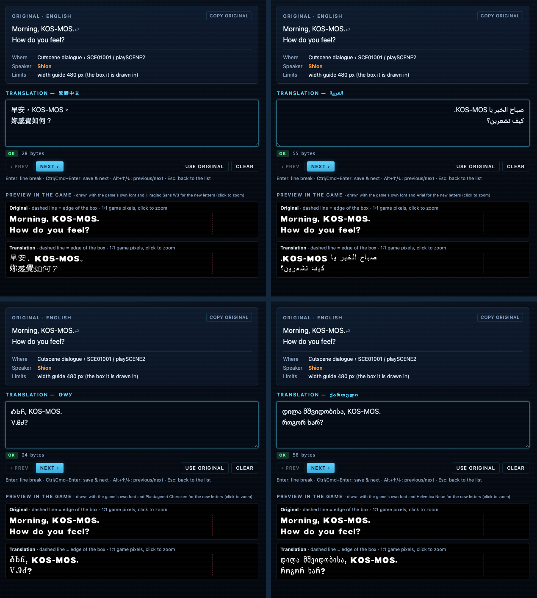
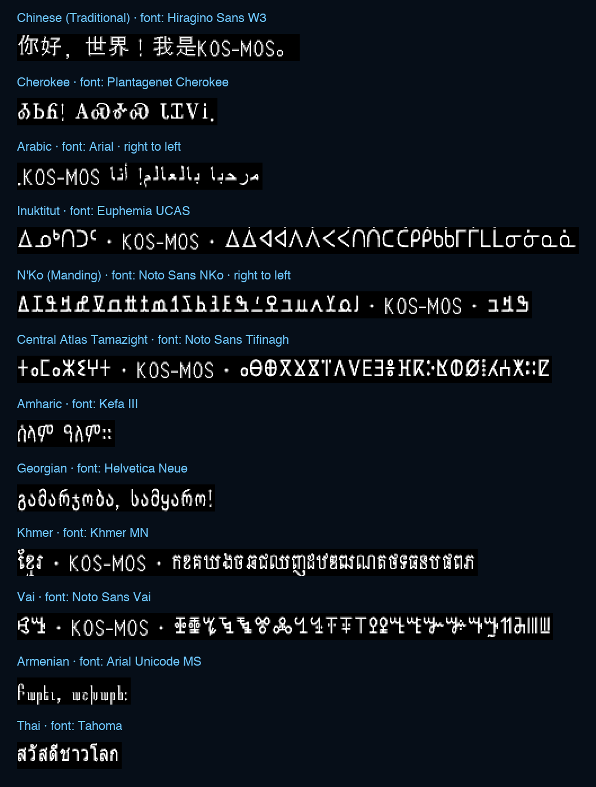

# The translation editor

*New here? Start with the step-by-step guide,
[TRANSLATING.md](TRANSLATING.md). This page is the full reference.*

One page in the app that lists every string of Xenosaga Episode I (USA)
a translator might want to change, sorted by what it is: field and
cutscene dialogue, speaker names, choices, U.M.N. mails, database and
chats, items, skills, enemies, menus, battle words, key items, the card
game, the casino and the enemies' battle quotes. You type or paste
translations, the page checks each one as you go, and **Build** writes a
patched copy of the disc. The retail image is only ever read.

It works for any language: French, Spanish and the other languages the
game's own font can already write need no setup at all, and every other
alphabet is drawn from a font on your computer when you build (see
[Target languages](#target-languages)). The older command-line tools
(the three export/import text trees, `lang scan`, movie subtitles) still
work as before; see [Limitations](#limitations).

## Starting it

* **On its own:** double-click `translate.bat` (Windows),
  `translate.command` (macOS) or `translate.sh` (Linux), or run
  `python gui.py --editor`. The editor opens directly; nothing of the
  extractor has to be run first. (The release app takes the same
  `--editor` argument.)
* **From the extractor app:** click **Translation editor** in the header,
  or open card 7.9 and click **Open the translation editor**. The page
  opens in a new tab at `/editor`.
* **Headless:** `PORT=8931 python3 gui.py --no-browser`, then open
  `http://127.0.0.1:8931/editor`.
* **Terminal only:** `python cli.py tx-catalog --iso GAME.iso --out catalog.json`
  writes the same list of strings as JSON;
  `python cli.py tx-build --project P.json --retail GAME.iso --out FR.iso`
  is what the Build button runs.

The first time a disc is opened, the editor reads all four string
families from it (about 10 seconds); after that the list comes from a
cache in `~/.cache/xs1-txeditor/`, which is thrown away by itself
whenever one of the reader modules changes.

## The workflow, for French or Spanish

The page always shows four numbered steps across the top; the one to do
next is lit, and the empty panes say in plain words what to do. The text
you translate from is the USA disc's English. (The Japanese strings left
on that disc are developer/debug text; they are hidden by default.)

1. **Disc.** *Choose disc…* and pick the untouched USA image. The
   picker lists the Xenosaga Episode I (USA) images it finds nearby, the
   untouched one first (marked ✓) and changed copies apart; other games
   are left out. You can also paste a path into its path box. Not a patched copy: every build
   starts again from retail, and row ids are retail addresses.
2. **Language setup & project.** **New** (or **Set up…** once a project
   is open) opens the Language setup: search the list of 382 languages
   (by English name, own name or code) or choose *My language isn't listed* and paste a sample
   sentence. Each language says what it needs: *ready* (the game font has
   every letter), *a few letters from a font*, or *new script · font*. When a
   font is needed, the installed fonts that draw every letter are listed
   (plain sans faces first, the right regional face for Chinese, Japanese
   and Korean) and the best one is picked for you; *Use a font file…* takes
   any .ttf/.otf/.ttc. *Try it* draws a sentence with the game's font as
   it will look after Build. With **Advanced** on, the setup also picks
   the source (English, or the Japanese of the Reloaded disc) and
   right-aligned dialogue for right-to-left languages. *Next* then asks
   where the project file goes. The project is a
   small JSON file (by default `<disc name> (FR).json` next to the disc)
   holding only what you typed:
   `{"format": 1, "language": "fr", "retail_id": "...", "translations": {id: {"text", "state"}}}`.
   Keep it under version control; it is your source of truth. **Open…**
   loads one you already have. It saves itself 1.5 s after each edit
   (Ctrl/Cmd+S, or clicking the save status, saves at once). Lines typed
   before a project exists are kept in the tab (not on disk: a reload
   loses them) and go into the project when it is created.
   **One project, one language.** Once a project holds a translated line
   its language is locked: Set up… still changes the font and the
   options, but choosing another language is refused with a pointer to
   **New**. With **Advanced** on, the setup shows *Change this project's
   language anyway* for a project set up as the wrong variant; it makes
   a checkpoint backup first and does not convert the lines already
   translated.
3. **Translate.** Three columns:
   * **Where in the game** (left) has three views. *By type* sorts the
     categories into Story, Menus & system, Items/skills/enemies, U.M.N.
     network and Mini-games, with plain names (Cutscene dialogue, Field
     dialogue, Choices, E-mail…). *By speaker* lists every dialogue line
     under the name in its name box, most lines first, then scene by scene;
     the Japanese name boxes cutscenes pass (【シオン】) are shown under the
     English label the USA disc gives the same speaker (`txspeakers.json`,
     paired from the USA and Reloaded discs by `txspeakers.py`). *By file*
     is the readers' own layout. In each view: category → group (a map like
     `ST0210`, a cutscene method like `SCE01001 / playSCENE5`, a mail
     `umn/0003`, an overlay table like `OV01 itmNameTbl`), each with a
     few words of what it holds (a mail's subject, otherwise its first
     line) and translated/total counts. Clicking a group opens its first
     untranslated line with the cursor in the translation box.
   * **Original** (middle): the English lines of that group, one row
     each, with a status dot (untranslated, translated, draft, warning,
     error, locked), your translation under it and the speaker or owner
     on the right (search results lead with the group, e.g.
     `umn/0002 · sender`). Search (English, translation, id, context,
     every category; Enter opens the first match) and the filter
     (untranslated, translated, problems, errors, warnings) sit above it.
     ↑/↓ (PageUp/PageDown, Home/End) move, Enter goes to the translation
     box (or opens the first listed line when the open one is not in the
     list).
   * **Translation editor** (right), for the highlighted line: the
     original with its protected tokens drawn as chips (a long mail or
     database entry scrolls inside its card, with *Show all*, so the box
     stays on screen; Japanese debug lines are labelled Japanese), where
     it appears, speaker, font, limits and id; then the box labelled
     *Translation — Français*. Under it the checker: errors (block the
     build), warnings (do not), bytes against the limit when the string
     cannot grow, pixels against a width guide where there is one (item,
     skill and equipment lists use the widest English entry of their
     column). **Length.** Most rows have no hard limit, so the checker
     also compares each translation with what the original game itself
     shows: *N% of the original's length* (drawn width of all lines,
     100% = the same) is always shown; a line wider than the row's box
     gets a **Wrap to fit** button that breaks it at spaces (it never
     splits a `/[...]` tag and keeps ? ! : ; » with the word before);
     and a warning says when the text would take more lines on screen
     than any original text of its category (rows with a width guide),
     or is longer than the longest original text of its category (rows
     the engine wraps by itself, such as field dialogue). These are
     warnings: the box sizes are not decoded, so the emulator has the
     last word. The original and your translation are drawn with the game's
     own font automatically as you type, shrunk to fit the pane; click
     for real size. *‹ Prev* / *Next ›* (Ctrl/Cmd+Enter =
     next, Alt+↑/↓), *Use original*, *Clear*; Esc goes back to the list.
     Locked lines show why instead of a box.
   * **Translation memory:** when the same English appears elsewhere the
     editor says how many untranslated copies will get your text (as
     drafts) when you move on, and how many already use it. Drafts are
     built into the ISO like any translation; *Accept draft* (or any
     edit) marks one as checked.
   **Saving and backups.** The project saves by itself 1.5 s after each
   change; **Save** (top right, or Ctrl/Cmd+S) saves at once. **Backups**
   opens the backup window. Copies live in a `<project name> backups/`
   folder next to the project file:
   * *automatic*: just before a save replaces the file, the server copies
     the file as it was, at most once every 10 minutes and never twice the
     same. The newest 20 are kept, plus the last one of each of the past
     30 days.
   * *checkpoint*: a copy you name yourself, e.g. "End of disc 1 –
     Woglinde" (the box suggests the place open on the left and the line
     count). Never deleted by the editor.
   * *before restore*: **Restore…** on any backup first keeps the project
     as it is now, so a restore can be undone.
   *Save a copy elsewhere…* writes the project to another folder (a USB
   stick, a cloud-synced folder) as `<name> copy <date>.json`.
   Terminal: `python3 txbackup.py list|checkpoint|restore PROJECT.json …`.
4. **Build ISO.** Opens the build drawer: give an output name (by
   default `<disc name> (FR).iso`), click **Build** and watch the log.
   Build stays disabled until steps 1 and 2 are done. If the checker
   already marks errors, the editor says so first (*Show them* / *Build
   anyway*: the build refuses error rows and writes nothing); ids in the
   log are links to their lines. A finished build shows the output path
   with a *Copy path* button.

**Simple and Advanced.** The page opens in Simple mode: the list shows
who says a line (or which part of a mail it is), and the editor shows
where it is, the speaker and a byte limit only when the string has one.
The **Advanced** switch (top right) adds ids, the context symbol, the
font, every limit, TSV import/export, hidden lines and the setup's
extra options. It is remembered per browser.

**Bulk ▾** (above the list) holds the tools for whole groups:
*Copy group for translation* puts the group's untranslated lines on the
clipboard as numbered lines (`[1] text`, `⏎` for line breaks) to
translate elsewhere; *Paste translations into group* reads them back with
a per-row preview first. *Export TSV* / *Import TSV* (`id`, `source`,
`translation`, with `\n`, `\t`, `\\` escaped) do the same for
spreadsheets. *Show hidden lines* and *Translation memory* are toggles.

## What each category covers

| Category | Where it lives on the disc | Notes |
|---|---|---|
| Dialogue — field maps | `scene\ST*.evt`, the Java string pool | any length; containers grow |
| Dialogue — cutscenes | `scene\SCE*.evt` (chain 1) | any length; drawn with font0 (see below) |
| Speaker names | the `/[label(...)]` name boxes in the scripts | the 【…】 strings cutscenes pass are never drawn: locked |
| Choices & menus (scripts) | choice lists in the scripts | keep the number of lines |
| U.M.N. mail | `umn\00NN.uml` | subject, sender, body; the mail folder list (`header.lst`) is rebuilt to match |
| U.M.N. database | `umn\9NNN.uml` | title and body; `dbheader.lst` rebuilt to match; grouped by the letter sections of `db_fileno.txt` |
| U.M.N. chat | `umn\eventNN.txt` | `\NN` escapes are engine codes; a chat file holds at most 8,192 bytes |
| Items & equipment, Skills & ether, Enemies, Battle HUD, Field menu & system, Title / install / U.M.N. UI, Robot battles | C strings inside `SLUS_204.69` and `OV01`–`OV12` | long strings move to the end of the overlay and every reference is repointed |
| Card game, Casino | overlay strings plus `carddata\card.dat` and `tanaka\CASINO.res` | card text grows freely; casino fields are fixed slots |
| Key items | `karakama\evtitem.dat` | name and description share 128 bytes |
| Save-screen locations | `endou\savemap.bin` | 32 bytes per name |
| U.M.N. plug-ins | `endou\umn\umntxt.bin` | fixed slots |
| Junk parts & extras | `endou\mapex.bin` | three string blocks |
| Enemy battle quotes | `yamamoto\think\think*.bin` | fixed slots; a shorter text is padded with spaces |

Groups are labelled only with names found on the disc (file names,
symbol names, speaker labels).

## Hidden and locked rows

The catalog lists every string the readers find (about 56,000), not just
dialogue, so you can see the context. Two flags keep the noise away:

* **Hidden** rows are not shown unless you tick *show hidden*: debug
  prints (`System.println`), Japanese developer text, asset ids, file
  paths, printf formats, lines no script ever draws. They can still be
  translated if you find one that does appear in the game.
* **Locked** rows cannot be edited, and the row says why: identifiers the
  code looks up by name, story-flag and scene-jump names (`XEVE*`), class
  and member names, speaker arguments the scripts never draw, keyword
  tables, Java native names, pointer words and binary data. Changing
  those would break the game rather than translate it; they are
  reference only.

## Accents

You type normal Unicode. The codec (`txcodec.py`) writes the codes the
game's fonts actually draw:

* **Field font** (dialogue, menus, U.M.N., items): accented Latin,
  « » ¿ ¡ œ Œ … and friends come from the font's accent block; ASCII
  stays ASCII. ’ and ” are written as ASCII `'` and `"` (the font draws
  those curly). A `#` followed by two characters would be read as an
  escape by the engine, so a literal `#` is written as its own code. A
  typed `\` is drawn as ¥. Anything the engine cannot draw (including
  every character that would need a `0x8F` JIS X 0212 byte) is an error
  with its position.
* **Two faces.** `font1` draws the field, menus and the U.M.N.; `font0`
  only the "ev" cutscenes. The two disagree on the grave and acute
  accents of È É Ì Í Ò Ó Ù Ú and their lower case, so each row is
  encoded for its own face; you do not have to think about it. (Which
  cutscene containers use `font0` is inferred from retail's own spellings,
  not traced scene by scene.)
* **Capital accents.** Retail `font0` draws È É Ê Ë as a plain E. When a
  translation uses them, Build redraws those four capitals in `font0`
  with the accents of the same font's À Á Â Ä, same size, and patches the
  font. The preview already shows the fixed font.
* **Pasted spacing.** No-break and thin spaces (what DeepL, Word and
  French keyboards put before ? ! : ; » and after «) are written as plain
  spaces, soft hyphens and zero-width characters are dropped, and
  decomposed accents (e + combining acute) are joined; each with a
  warning, in every font. An error names any invisible character it
  cannot write (e.g. `U+2028 LINE SEPARATOR`).
* **Em dash.** Retail stores no metrics for the cells of — ‾ and `_`, and
  the engine then draws only a 5 px slice of them. When a translation
  uses one, Build gives those cells metrics that draw the whole glyph
  (both faces); retail's own `———` rules then draw in full too.
* **Battle font** (the 10-pixel HUD letters: enemy names, tech names,
  "End", "Menu"): accented letters are drawn through `#XX` cell escapes.
  The grid has no à or â; those fold to `a` with a warning. The HUD
  centres a label by its byte count, so each escape moves it 10 px left.
* **Ribbon font** (the ASCII-only title ribbons): everything folds to
  plain ASCII, with a warning.

## What Build does

1. checks the project was made for this disc (its retail id: a hash of
   the boot executable, the overlays and the three TOC files);
2. validates every translation of every family against retail; if any
   fails, it stops with a list of row ids and reasons, and nothing is
   written;
3. makes `OUT.iso.partial`: an APFS clone on macOS when the output is on
   the retail image's own volume (instant, costs no space), a reflink on
   Linux, otherwise a full copy after checking there is room for it plus
   1 GiB;
4. writes the U.M.N., script, overlay and fixed-table families, each
   from the retail bytes;
5. applies the capital-accent and em-dash font fixes if needed;
6. reads every translated row back out of the new image with the same
   readers and compares it with what you typed, and checks that no two
   objects on the disc overlap;
7. renames the file to `OUT.iso`. A build that fails at any point deletes
   the partial file, so a file under the final name is always a finished
   one. An existing output is replaced only with *replace if it exists*
   ticked (`--overwrite`).

A build of a few dozen strings takes about 11 seconds, most of it
validation.

## Target languages

`txtarget.py` decides how each target language is drawn (`python3
txtarget.py list` prints the table). The Language setup offers **382
languages**: the 47 long-tested ones below first ("Most asked for"), then
every entry of the language registry `txlangs.py` A–Z, among them Cherokee
(syllabary), Inuktitut, Cree and Ojibwe (Canadian syllabics), Navajo,
Hawaiian, Māori, Yoruba, Welsh, Tamazight (Tifinagh), N'Ko, Fula (Adlam),
Vai, Santali (Ol Chiki), Tibetan, Khmer, Lao, Burmese, Sinhala, Dhivehi,
Yi, Cantonese and Ainu. Each registry line gives the language's letters;
the kind (below) is computed from them against the retail fonts, never
written by hand, and the letters of the language's own name count too.
The setup shows the registry's orthography notes (the ʻokina is U+02BB,
traditional Mongolian is vertical but this game prints rows, ...), and
searches by English name, own name, code, script or country code. Every
one of the 382 has been drawn through the Try-it path with an installed
macOS font (the best-ranked one); Cherokee, Inuktitut, Tamazight, N'Ko,
Yoruba and Hawaiian were also built into an ISO and read back. Adding a
language = one line in `txlangs.py`.

The same cutscene line in four scripts, as the editor shows it (the
translation box, then the preview drawn with the game's font and the
chosen TrueType font):

Sample lines from the Language setup's *Try it* box for twelve scripts:

These are the editor's previews, not in-game captures. Known weak spots:
brackets and numbers next to Latin words in a right-to-left line can land
on the wrong side (text is reordered word by word), and Tibetan stacks
do not form with the fonts tried so far.

| Kind | Languages (examples) | What Build does |
|---|---|---|
| builtin | French, Spanish, German, Italian, Portuguese, Dutch, Catalan, Swedish, Danish, Norwegian, Icelandic, Irish | nothing new: the retail accent block has every letter (the path above) |
| script-hybrid | Polish, Czech, Slovak, Hungarian, Romanian, Turkish, Croatian, Lithuanian, Latvian, Esperanto, Vietnamese, Finnish/Estonian (ž) | letters the block has stay retail; the others are drawn from a TrueType font into free cells |
| japanese | Japanese | kana, punctuation and level-1 kanji are drawn by the retail font; each level-2 kanji (EUC rows D0+, which are the accent block on this disc) is drawn from a Japanese font into a kanji cell the translation does not use |
| script | Russian, Ukrainian, Bulgarian, Serbian, Greek, Armenian, Georgian, Arabic, Persian, Hebrew, Hindi, Thai, Amharic, Korean, Chinese, or "other" with any script and font | every letter shaped with HarfBuzz and drawn from the font; right-to-left text is ordered, wrapped and optionally right-aligned at build time |

The kind is computed from the language's alphabet against the retail fonts.
The project stores only the choice:

    "target": {"code": "ru", "font": "/Library/Fonts/NotoSans-Regular.ttf"}

(optional: `kind`, `script`, `rtl`, `face` for a .ttc, `px`, `baseline`,
`xscale`, `align` (`right` for RTL dialogue), `wrap`, `battle_font`,
`battle_px`, ...; see `txtarget.normalise_target`). The glyphs are worked out
again from your text on every build, so a build is reproducible from the
project and the font.

What changes for a new-script build: every translated string of every
family goes into ONE glyph allocation (dialogue font cells; cells that
untranslated English or your own accented letters still use are never
taken), each changed string is then encoded on its own, and font0, font1,
the battle grid (`stat.xtx`) and its byte table in OV01 are patched in the
same build. Window title ribbons (the tag font) only have A-Z a-z 0-9:
a non-Latin letter there is refused with the row id. A build that needs new
glyphs uses `fonttools` and `uharfbuzz` (required kit packages; the
launchers install them; on a Python that refuses `pip install --user`
under PEP 668, such as Homebrew's or Debian/Ubuntu's, they create a `.venv`
folder in the kit and install there). Builtin projects build
byte-for-byte as before.

Right-to-left rows are reordered word by word, so a colour tag
(`/[color(...)]`), another `/[...]` tag, a chat `\NNN` code or a `⟦XX⟧`
control code in the **middle** of a right-to-left line would end up on
other words; Build refuses such a row with its id and the tag. At the start
or end of a line they are kept (put a coloured phrase on its own line).
`%d`/`%s` fields are allowed: they move with their word.

In the battle grid, new letters take the empty cells after the accented
Latin (125 and up) first; an accented letter that an edited or untranslated
battle label draws with a `#XX` escape keeps its cell. A combining mark or
dot goes into the same cell as its own letter (HarfBuzz cluster).

Limits seen in renders: the battle grid is 10 px a letter, so Arabic letters
there cannot join up and kanji/kana are cramped; the TrueType letters are
regular weight next to the retail font0 Latin, which is bold.

## Japanese as the source (txsource.py)

The rows are keyed to the USA disc, but a translator can read the
Japanese original instead: `txsource.py` finds, for each USA row, the
same string on **Xenosaga Episode I Reloaded** (SLPS_290.05), the 2003
Japanese rebuild of the USA code. Nothing is written to either disc.
In the page: Language setup → Advanced → *Translate from: Japanese*; the API (`sources`, `identify_disc`,
`align`, `display_ja`) is documented at the top of the module.

* Field and cutscene dialogue are paired by **code position** (the n-th
  string load of the same method), not by constant-pool index, which
  differs between the discs; message arrays are paired as units. When
  the two scripts cut a message differently (different pages, or the
  same number of pages holding different parts of the text, which shows
  as page lengths that do not correspond), each USA piece shows the
  whole Japanese message (listed as `partial`). `texts` never holds a
  blank or whitespace-only value, and empty USA speaker labels get no
  Japanese name.
* Mail, chat, key items, plug-ins, junk parts, cards, casino and battle
  quotes are paired by file and record. Database pages are numbered in
  each language's alphabetical order; only the pages that can be paired
  by evidence (numbers, acronyms, last page of a header group) get
  Japanese.
* Menu, item, skill and enemy strings in the executables are paired by
  matching each USA function in the stripped Reloaded binary and by
  placing each string table at a displacement that keeps its layout.
* Rows that cannot be paired reliably are left without Japanese rather
  than guessed. Coverage on the retail pair (visible rows): dialogue
  99.6%, U.M.N. mail and chat 100%, database 28%, items 98%, skills
  99.5%, enemies 100%, field menu 34%, save-screen names 0% (the file is
  not on Reloaded). `python3 txsource.py selftest --usa USA.iso --source
  RELOADED.iso` prints the full table and sample pairs.
* The 2002 original Japanese disc (SLPS_250.xx) is recognised and
  refused with "not supported yet".

## Limitations

* **Movies** carry no subtitle track; use the subtitle cards
  ([SUBTITLES.md](SUBTITLES.md)).
* **Do not mix pipelines on one disc.** The editor builds from retail
  every time. A disc already patched by `text-import`, `evt-import` or
  `ovl-import` is refused as a base when its executables or TOC changed
  or any object sits past its chain's end (whatever the project's retail
  id), but a same-length in-place patch cannot be detected; always point
  the editor at the untouched image. Two builds to the same output are
  refused (`OUT.iso.lock`), and only Xenosaga Episode I (USA),
  `SLUS_204.69`, is accepted as a disc.
* **Strings drawn by two printers.** Enemy names also appear in the
  Analyze window and weapon names in item messages, both in the field
  font; an accented name can only be right in one of the two places. The
  row's context says so, the checker warns with what each printer will
  show, and Build logs the same warning.
* **Width guides are guides.** The 480 px cutscene guide is the scene
  window's width (``TWIN_SCENE_WIDTH``); about 6% of retail cutscene lines
  are wider too, because the engine wraps them.
* **U.M.N. pages:** blank lines at the very start or end of a mail or
  database text count as part of the page frame, not as the row's text.
* **Nothing built by the editor has been booted in PCSX2 yet.** Every
  build is verified by reading the image back, which proves the bytes,
  not the screen. Check a few translated screens in the emulator before
  you trust a whole project.
